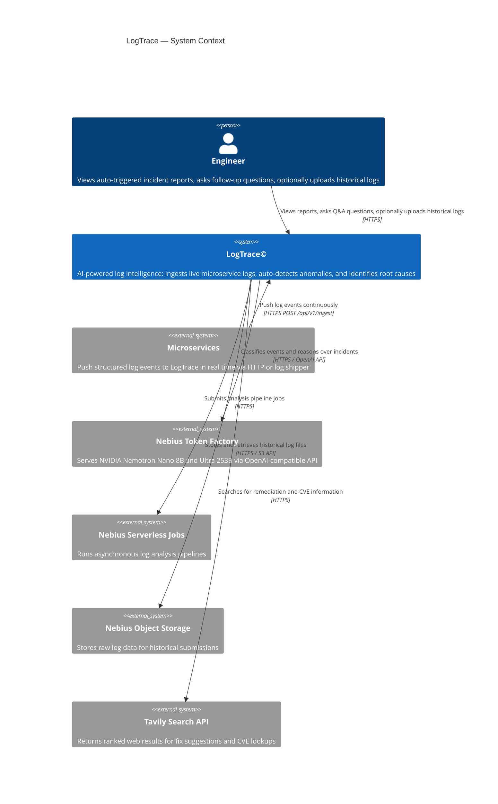
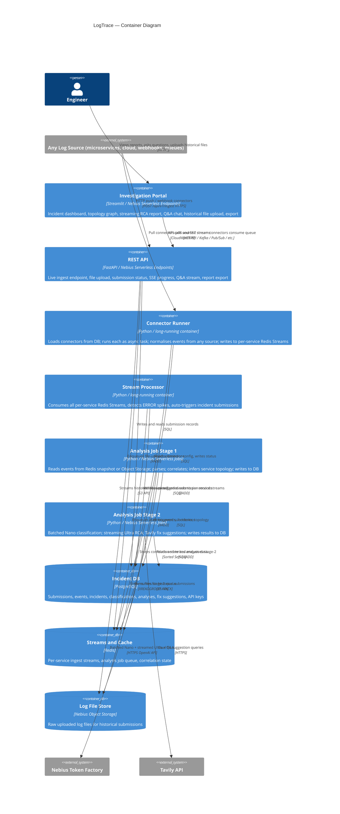
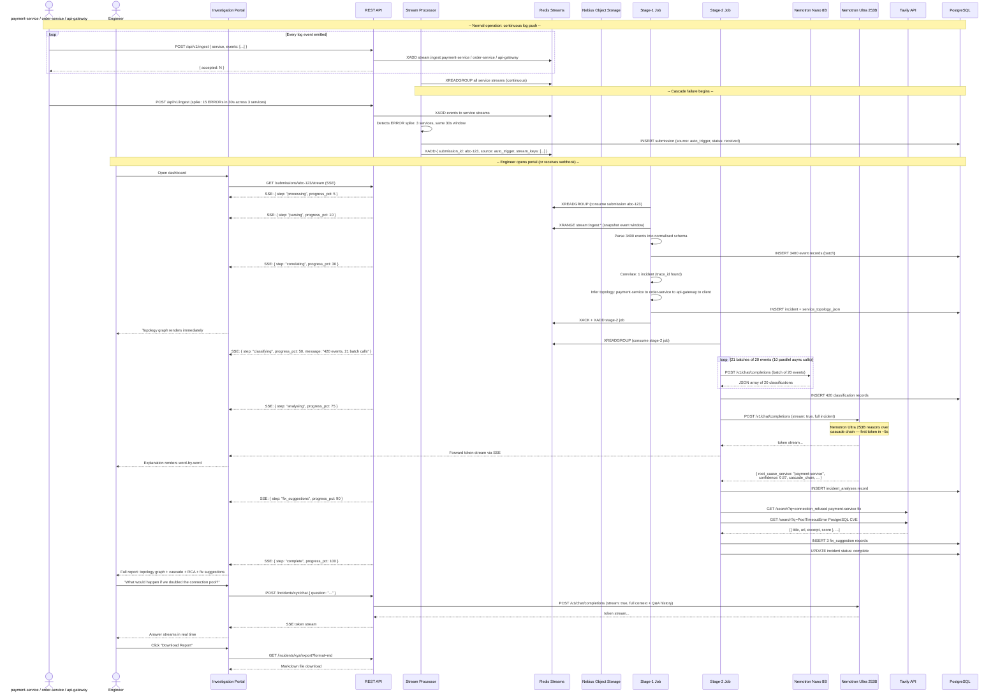
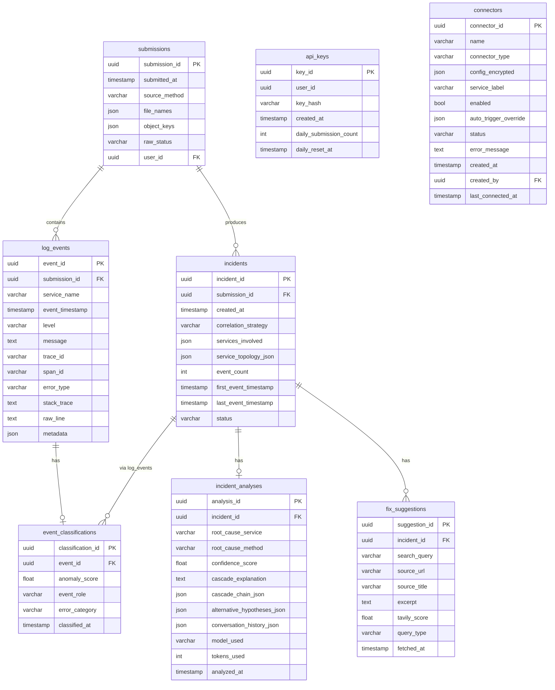

# LogTrace©
# High Level Design

---

**Document ID:** NMT-HLD-001

**Revision History:**

| Rev. | Date       | Author                  | Details                                                                                          |
|------|------------|-------------------------|--------------------------------------------------------------------------------------------------|
| 1    | 19/09/2026 | Anastasya Sevastianova  | Document Creation                                                                                |
| 2    | 19/09/2026 | Anastasya Sevastianova  | Simplified: file upload only; recommended log format defined; logfmt and CLI removed; solo scope |
| 3    | 19/09/2026 | Anastasya Sevastianova  | Architecture hardened: Object Storage replaces Redis raw-file buffer; Redis Streams replaces Redis List; Interactive Q&A, SSE progress, streaming RCA, service topology graph, export endpoint added; Open Issues 4/6/7 resolved; ADRs added |
| 4    | 19/09/2026 | Anastasya Sevastianova  | Design gaps resolved: Nebius Serverless Jobs runtime constraints specified (§3.5, ADR-003); topology inference algorithm added (§2.1 §3); topology graph visual spec added (§2.1 §8) with node/edge styling, animation, interaction; Fix Suggestions elevated to prominent card position; Open Issues 5/8 closed |
| 5    | 19/09/2026 | Anastasya Sevastianova  | Hackathon compliance pass: Nebius services summary table added (§3.5); README required sections specced (§2.8); demo video outline added (§2.8); §11 Feedback Notes added; Open Issue #9 expanded to cover model ID verification; duplicate ADR-007 renumbered to ADR-008; §10 checklist expanded with judging criteria mapping; ToC updated |
| 6    | 19/09/2026 | Anastasya Sevastianova  | Time estimation updated: Connector System (5 days) and Demo Log Files (2 days) added as explicit line items; total revised from 62 to 69 days; critical path Week 3/5 updated to reflect connector and demo work; REST API and Portal rows updated to include connector endpoints and Ecosystem Map |
| 7    | 19/09/2026 | Anastasya Sevastianova  | Deadline feasibility pass: Connector System scoped to `http_push` only for submission (5 → 2 days); remaining connectors deferred as stretch goals; unit tests reduced to critical path (4 → 3 days); integration tests reduced (2 → 1 day); total revised from 69 to 64 days (1.56x pace over 41 calendar days); §10 checklist updated |
| 8    | 19/09/2026 | Anastasya Sevastianova  | Time estimation aligned with actual code: status column added to §5 table (✅/🔶/⬜ per component); ~11 days complete (ingest endpoint, DB schema, Redis, Object Storage client, REST API skeleton, demo producers, Docker base); ~53 days remaining; pace revised to 1.29x/day; critical path updated — Week 1 marked done, Stream Processor elevated as current highest priority |

---

**Abstract:**

LogTrace© is an AI-powered log intelligence system for microservice environments. Given unstructured, disorganised logs from multiple services, LogTrace correlates related events, identifies cascade failure chains, and applies NVIDIA Nemotron reasoning models — served via Nebius Token Factory — to pinpoint the root cause of an incident with a confidence score and a plain-language explanation. Engineers no longer need to manually grep through dozens of log files: they upload logs and receive a diagnosis in seconds.

The system features a two-model pipeline — both open-weight NVIDIA models served via Nebius Token Factory:

- **`nvidia/Llama-3.1-Nemotron-Nano-8B-Instruct`** — rapid, batched per-event anomaly classification
- **`nvidia/Llama-3.1-Nemotron-Ultra-253B-v1`** — deep causal reasoning and interactive Q&A

Together with a real-time service topology graph and Tavily-powered fix suggestions, LogTrace closes the full loop from detection to remediation.

This document is the High Level Design (HLD) of the system, describing the system architecture, the main components and their relationships, the overall data flow and processing, and any external systems and dependencies.

---

## Contents

1. [General](#1-general)
   - 1.1 [Introduction](#11-introduction)
   - 1.2 [Glossary](#12-glossary)
2. [Requirements](#2-requirements)
   - 2.1 [Logical (System Functionality)](#21-logical-system-functionality)
   - 2.2 [User Workflow](#22-user-workflow)
   - 2.3 [Availability and Recovery](#23-availability-and-recovery)
   - 2.4 [Performance & Capacity Requirements](#24-performance--capacity-requirements)
   - 2.5 [Scalability](#25-scalability)
   - 2.6 [Security](#26-security)
   - 2.7 [Monitoring and Debugging](#27-monitoring-and-debugging)
   - 2.8 [Deployment](#28-deployment)
   - 2.9 [Backward Compatibility](#29-backward-compatibility)
3. [High Level Design](#3-high-level-design)
   - 3.1 [System Architecture](#31-system-architecture)
   - 3.2 [Processes](#32-processes)
   - 3.3 [Design Rules and Principles](#33-design-rules-and-principles)
   - 3.4 [Upgradability](#34-upgradability)
   - 3.5 [Assumptions and Dependencies](#35-assumptions-and-dependencies)
4. [Architecture Decision Records](#4-architecture-decision-records)
5. [Time Estimation](#5-time-estimation)
6. [Limitations and Reservations](#6-limitations-and-reservations)
7. [Risks](#7-risks)
8. [Open Issues](#8-open-issues)
9. [Technology Stack](#9-technology-stack)
   - 9.1 [Language — Python 3.12](#91-language--python-312)
   - 9.2 [Component-by-Component Stack](#92-component-by-component-stack)
   - 9.3 [Key Technology Decisions Summary](#93-key-technology-decisions-summary)
10. [HLD Review Checklist](#10-hld-review-checklist)
11. [Feedback Notes (Nebius / NVIDIA)](#11-feedback-notes-nebius--nvidia)
    - 11.1 [Nebius Token Factory](#111-nebius-token-factory)
    - 11.2 [Nebius Serverless Jobs](#112-nebius-serverless-jobs)
    - 11.3 [Nebius Serverless Endpoints](#113-nebius-serverless-endpoints)
    - 11.4 [Nebius Object Storage](#114-nebius-object-storage)
    - 11.5 [NVIDIA Nemotron Models](#115-nvidia-nemotron-models)
    - 11.6 [Tavily](#116-tavily)

---

## 1. General

### 1.1 Introduction

In modern microservice architectures, a single root failure in one service propagates silently across dependent services, producing a cascade of errors that appear in dozens of separate log files. Diagnosing the original cause requires an engineer to manually correlate timestamps, error codes, and stack traces across all affected services — a process that commonly takes two to four hours per incident and requires deep familiarity with the entire system.

The LogTrace© system eliminates this burden. It ingests raw logs from any number of microservices, normalises them into a unified schema, correlates related events into an incident chain, and applies two open-weight NVIDIA Nemotron models served via Nebius Token Factory:

- **Nemotron Nano 8B** (`nvidia/Llama-3.1-Nemotron-Nano-8B-Instruct`) — for fast, per-event anomaly classification (batched, async)
- **Nemotron Ultra 253B** (`nvidia/Llama-3.1-Nemotron-Ultra-253B-v1`) — for deep causal reasoning over the full incident chain (streamed response)

The output is a root cause report that names the originating service and method, assigns a confidence score (e.g. 87%), explains the cascade sequence step by step, visualises the service dependency graph, and optionally queries the Tavily search API to surface known solutions and documentation for the identified error pattern. After the initial report, engineers can ask follow-up questions in a built-in Q&A panel, powered by Nemotron Ultra with full incident context.

LogTrace is submitted to the **Best Apps and Agents Track** of the Nebius × NVIDIA Global AI Hackathon.

---

### 1.2 Glossary

| Term | Definition |
|------|-----------|
| Cascade Error | A failure that originates in one service and triggers failures in downstream dependent services, often making the root cause difficult to identify |
| Root Cause | The original event or failure from which all subsequent errors in the cascade can be traced |
| Root Cause Analysis (RCA) | The process of identifying the root cause of an incident, typically done manually by examining logs |
| Log Event | A single line or structured record emitted by a microservice, containing at minimum a timestamp, severity level, and message |
| Log Ingestion | The process of receiving log data from the user via file upload |
| Normalisation | The process of parsing logs of different formats (JSON, plaintext) into a common internal schema |
| Correlation | Grouping log events from different services that belong to the same incident, using trace IDs or time-window proximity |
| Trace ID | An identifier propagated across service boundaries in distributed tracing systems (e.g. OpenTelemetry), allowing all events from a single request to be grouped |
| Span ID | A per-operation identifier within a distributed trace |
| Incident | A correlated set of log events representing a single failure propagation across one or more services |
| Cascade Chain | The ordered sequence of failures from root cause to final observable symptom |
| Service Topology | A directed graph of service dependencies inferred from the cascade chain |
| Confidence Score | A probability estimate (0–100%) expressing the model's certainty that the identified root cause is correct |
| Nemotron Ultra 253B | Open-weight NVIDIA reasoning model (`nvidia/Llama-3.1-Nemotron-Ultra-253B-v1`); used for deep causal analysis and interactive Q&A; served via Nebius Token Factory |
| Nemotron Nano 8B | Open-weight NVIDIA fast-inference model (`nvidia/Llama-3.1-Nemotron-Nano-8B-Instruct`); used for batched per-event anomaly classification; served via Nebius Token Factory |
| Nebius Token Factory | Nebius AI's serverless LLM serving platform, providing an OpenAI-compatible API for NVIDIA open-weight Nemotron models |
| Nebius Serverless Jobs | Nebius AI's service for running background and asynchronous compute workloads |
| Nebius Serverless Endpoints | Nebius AI's service for deploying REST API endpoints |
| Nebius Object Storage | Nebius AI's S3-compatible object storage; used to store raw log data for historical submissions |
| Redis Streams | A Redis data structure providing persistent, consumer-group–based message streaming with at-least-once delivery guarantees |
| SSE | Server-Sent Events — a unidirectional HTTP streaming protocol used for real-time progress updates |
| Log Ingest Endpoint | The LogTrace HTTP endpoint that receives a continuous stream of log events pushed by microservices or log shippers |
| Log Shipper | A lightweight agent (Fluent Bit, Vector, Logstash) running alongside a microservice that tails log files and forwards events to LogTrace via HTTP |
| Stream Processor | A long-running LogTrace component that consumes the live event stream, detects anomaly spikes, and auto-triggers incident analysis |
| Auto-Trigger | The automatic opening of an incident analysis when the Stream Processor detects a significant ERROR rate increase across services |
| Tavily | A search API optimised for AI agents; used to surface known error patterns and solutions |
| LLM | Large Language Model |
| RTO | Recovery Time Objective — the maximum acceptable time to restore service after a failure |
| SLA | Service Level Agreement |
| FastAPI | A modern Python web framework for building REST APIs |
| PostgreSQL | An open-source relational database |
| Redis | An in-memory key-value store and stream engine; used for job queue (Streams) and correlation state |
| Streamlit | A Python library for rapid web application development |

---

## 2. Requirements

### 2.1 Logical (System Functionality)

Engineers working with microservice systems face the following specific problems:

1. Log files from different services use different formats (JSON, plaintext, logfmt, custom patterns).
2. There is no common identifier linking related events across services unless distributed tracing is enabled.
3. Cascade errors make the root cause invisible: the first service to surface an ERROR may not be the origin.
4. Searching manually through logs scales poorly beyond 5–10 services.

The LogTrace© system must address all four problems. The system should have the following capabilities:

---

#### 1. Log Ingestion

LogTrace supports **two ingestion modes**. The primary mode is **automatic streaming push** from live microservices; the secondary mode is **historical file upload** for post-mortem analysis of stored logs.

---

##### 1a. Primary: Automatic Push from Services (Live Streaming)

Microservices (or the log shippers running alongside them) push log events to LogTrace in real time via a dedicated **Log Ingest Endpoint**. No manual action is required from the engineer. The system continuously monitors the incoming event stream and automatically triggers incident analysis when an anomaly pattern is detected.

**How services send logs:**

Services can integrate with LogTrace in one of the following ways, in order of preference:

1. **Direct HTTP push** — the service calls `POST /api/v1/ingest` with a batch of JSON log events (recommended for services that already emit structured JSON). A single API call can carry up to 500 events.
2. **Log shipper** — a lightweight shipper (Fluent Bit, Vector, or Logstash) runs as a sidecar or host daemon, tails the service's log files, and forwards events to LogTrace's ingest endpoint via its built-in HTTP output plugin. **Zero application code change required** — only a shipper config file pointing to `POST /api/v1/ingest`.
3. **OpenTelemetry Collector** — for services already using OTel, an HTTP exporter sends log records to LogTrace's OTLP-compatible ingest path.

**Ingest endpoint behaviour:**

```
POST /api/v1/ingest
  Content-Type: application/json
  Body: { service: str, events: [ { timestamp, level, message, trace_id?, ... }, ... ] }
  Response: { accepted: int, dropped: int }
```

Received events are appended to a **per-service Redis Stream** (`stream:ingest:{service_name}`). The Stream Processor consumes all service streams concurrently and watches for anomaly patterns.

**Auto-trigger:** The Stream Processor raises an incident automatically when any of the following conditions are met across the live event window (configurable; default: last 60 seconds):

- ERROR rate for any single service exceeds **10 events in 60 seconds**
- The same `error_type` appears in **3 or more services** within a 30-second window
- Any event contains level `CRITICAL`

When triggered, the Stream Processor groups all relevant events from the window into a new submission and enqueues it for Stage-1 analysis. The incident appears in the portal automatically — no engineer intervention needed until the report is ready.

---

##### 1b. Secondary: Historical File Upload

Engineers may upload stored log files through the Investigation Portal or the REST API for post-mortem analysis of past incidents. This path is also used for the portal demo mode ("Load Demo Logs").

Files may be `.log`, `.txt`, or `.json` format, up to 100 MB per submission, up to 20 files per submission.

**File storage:** Uploaded files are streamed directly to **Nebius Object Storage** (S3-compatible). Raw file content is never held in application memory beyond the initial upload stream. Only metadata and Object Storage keys are stored in the database and queue.

---

**Submission metadata stored for both modes:**

| Field | Size Estimation (chars) |
|-------|------------------------|
| submission_id (UUID) | 36 |
| submitted_at (ISO timestamp) | 26 |
| source_method (push / shipper / otlp / upload / auto_trigger) | 12 |
| file_names (JSON array, nullable — upload only) | 500 |
| object_keys (JSON array, nullable — upload only) | 600 |
| ingest_window_start (nullable — push only) | 26 |
| ingest_window_end (nullable — push only) | 26 |
| raw_status (received / processing / complete / failed) | 12 |
| user_id (if authenticated) | 36 |

---

#### 2. Recommended Log Format and Parsing

##### 2a. Recommended Log Format

For best correlation accuracy, services should emit logs as **JSON lines** (one JSON object per line), following the schema below. This format is supported natively by Python's `structlog` and `python-json-logger` libraries, and by most modern logging frameworks.

```json
{
  "timestamp": "2026-09-19T10:00:00.123Z",
  "level": "ERROR",
  "service": "payment-service",
  "trace_id": "4bf92f3577b34da6a3ce929d0e0e4736",
  "span_id": "00f067aa0ba902b7",
  "message": "Connection pool exhausted after 30s",
  "error_type": "PoolTimeoutError",
  "stack_trace": "Traceback (most recent call last):\n  ..."
}
```

Key fields and their purpose:

| Field | Required | Purpose |
|-------|----------|---------|
| `timestamp` | Yes | Ordering events across services |
| `level` | Yes | Filtering noise; identifying errors |
| `service` | Yes | Identifying the emitting microservice |
| `trace_id` | Recommended | Correlating events across services without time-window heuristics |
| `span_id` | Optional | Fine-grained tracing within a service |
| `message` | Yes | Human-readable description of the event |
| `error_type` | Optional | Exception class name; improves root cause classification |
| `stack_trace` | Optional | Full stack trace; improves Nemotron Ultra's diagnosis |

The `trace_id` field is the single most valuable field for LogTrace. When services propagate a `trace_id` header across HTTP or message queue calls, LogTrace can group all events from a single request chain with 100% accuracy, bypassing the less reliable time-window correlation heuristic.

##### 2b. Supported Input Formats

LogTrace supports two input formats:

1. **JSON lines** — the recommended format described above. Each line is a valid JSON object. The parser maps fields to the internal schema; unknown fields are stored in a `metadata` JSON column.
2. **Plaintext** — for existing services that cannot be easily changed. Lines of the form `[TIMESTAMP] [LEVEL] service_name: message` or common variations. Regex-based extraction is applied; fields that cannot be extracted are stored as NULL.

The parser detects format automatically per file (by examining whether the first non-empty line parses as valid JSON).

Each parsed log line is normalised into the following internal event schema:

| Field | Size Estimation (chars) |
|-------|------------------------|
| event_id (UUID) | 36 |
| submission_id (UUID, FK) | 36 |
| service_name | 50 |
| timestamp (ISO 8601) | 26 |
| level (ERROR / WARN / INFO / DEBUG) | 8 |
| message | 500 |
| trace_id (nullable) | 32 |
| span_id (nullable) | 16 |
| error_type (exception class, nullable) | 100 |
| stack_trace (nullable) | 2000 |
| raw_line | 1000 |
| metadata (JSON, nullable) | 500 |

If a field cannot be extracted from the raw line, it is stored as NULL. Unknown fields from JSON logs are preserved in the `metadata` JSON column.

Events where the level is DEBUG or INFO and no error keywords are detected may be filtered out before the correlation phase to reduce noise, unless the submission is flagged as "include all".

---

#### 3. Event Correlation

The Correlation Engine groups parsed events into incidents. The following correlation strategies are applied in order:

**Strategy A — Trace ID Correlation**
If `trace_id` is present in events, all events sharing the same `trace_id` are grouped into a single incident regardless of service or time.

**Strategy B — Time Window + Error Propagation Correlation**
If no trace IDs are present, the engine performs the following:
1. Identifies all events with level ERROR or CRITICAL within the submitted log set.
2. Applies a sliding time window of configurable width (default: 30 seconds) around each ERROR event.
3. Groups events across services whose timestamps fall within the same window.
4. Merges overlapping windows into a single incident.
5. Removes duplicate events (same service + same message within 1 second).
6. Orders grouped events by timestamp to form a candidate incident chain.

A single submission may produce more than one incident. Each incident is assigned an **Incident ID**.

The incident record stores:

| Field | Size Estimation (chars) |
|-------|------------------------|
| incident_id (UUID) | 36 |
| submission_id (UUID, FK) | 36 |
| created_at | 26 |
| correlation_strategy (trace_id / time_window) | 12 |
| services_involved (JSON array of names) | 300 |
| service_topology_json (adjacency list — inferred from cascade) | 1000 |
| event_count | 10 |
| first_event_timestamp | 26 |
| last_event_timestamp | 26 |
| status (pending / classifying / analyzing / complete / failed) | 12 |

The `service_topology_json` field encodes the directed dependency graph inferred from the ordered cascade chain. For example, `{ "payment-service": ["order-service"], "order-service": ["api-gateway"] }`. This graph is rendered as a force-directed visualisation in the Investigation Portal.

**Topology inference algorithm:**

The directed graph is built from the correlated event set as follows:

1. **Sort** all non-noise events in the incident by `timestamp ASC`.
2. **Sliding window edge detection:** For each ERROR/CRITICAL event from service A, look forward in the sorted list for the first ERROR/CRITICAL event from a *different* service B within a 5-second window. If found, add a directed edge A → B. This captures the propagation direction: A's failure caused B's failure.
3. **Trace-ID path (when available):** If events carry `trace_id` and `span_id`, reconstruct parent→child span relationships. Each span's emitting service contributes a directed edge from the parent service to the child service. This is more accurate than the time-window heuristic.
4. **Deduplication:** Multiple events from the same pair (A, B) produce only one edge in the graph. Edge weight = number of cross-service error pairs (used to scale edge thickness in the UI).
5. **Cycle detection:** A healthy cascade is a DAG. If a cycle is found (service A → B → A), break it at the edge with the lowest event count and flag it in the report as a possible bidirectional dependency or correlation false positive.
6. **Root node identification:** The root cause node is the service with in-degree 0 in the final DAG — or, if all nodes have in-degree > 0 (cycle was broken), the node whose first ERROR timestamp is earliest.
7. **Role assignment per node:**
   - `root_cause` — in-degree 0 AND confirmed by Nano/Ultra as root candidate
   - `propagated_error` — directly downstream of root cause (depth 1)
   - `symptom` — depth ≥ 2 from root
   - `unaffected` — service appears in logs with no ERROR events in the incident window

This algorithm is deterministic and runs in O(N log N) time (dominated by the sort). For the demo scenario (3 services, ~420 events), inference completes in < 100 ms.

---

#### 4. Anomaly Classification

For each ERROR/WARN event in an incident, the Anomaly Classifier Service calls **Nemotron Nano 8B** via Nebius Token Factory. To maximise throughput and minimise round-trips, events are **batched**: up to 20 events are packed into a single API call, with the model returning a JSON array of classification results.

The batch prompt structure:

```
Classify each of the following log events. Return a JSON array with one object per event in order.
Each object must have:
  - anomaly_score: float 0.0–1.0
  - event_role: one of [root_candidate, propagated_error, symptom, noise]
  - error_category: one of [timeout, null_pointer, connection_refused,
                             out_of_memory, authentication_failure,
                             data_corruption, unknown]

Events:
[1] Service: {service_name}, Level: {level}, Message: {message}
[2] Service: {service_name}, Level: {level}, Message: {message}
...
```

Events classified as `noise` are excluded from the root cause analysis step.

The classification output per event:

| Field | Size Estimation (chars) |
|-------|------------------------|
| classification_id (UUID) | 36 |
| event_id (UUID, FK) | 36 |
| anomaly_score | 5 |
| event_role | 20 |
| error_category | 25 |
| classified_at | 26 |

Batching reduces the number of API calls from O(N) to O(N/20), targeting a throughput of **200 events per second** (10 parallel batch calls of 20 events each).

---

#### 5. Root Cause Analysis

The Root Cause Analyzer submits the full correlated and classified incident to **Nemotron Ultra 253B** via Nebius Token Factory with **streaming enabled** (`stream: true` in the OpenAI-compatible API). The streamed response is forwarded token-by-token to the Investigation Portal via SSE, so the analyst explanation appears word-by-word — dramatically reducing perceived latency.

The analyzer constructs a structured prompt that includes:

1. A summary: number of services involved, time span of the incident, total event count.
2. The ordered cascade of non-noise events with service name, timestamp, level, message, anomaly score, and event role.
3. `[ROOT CANDIDATE]` markers on events flagged by the classifier.
4. Instructions to: reason step by step, identify the root cause service and method, explain the cascade, assign a confidence score (0–100%), and provide alternative hypotheses if confidence < 90%.

**Fallback when no `root_candidate` events exist:** All ERROR events sorted by `anomaly_score DESC` are used (capped at 50 events per service, 200 total). The prompt is prefixed with: *"No events were flagged as root candidates. Reason from first principles using the following ERROR events."*

**Truncation strategy for large incidents (> 200 non-noise events):** Events are first grouped by service; up to 10 events per service are kept (sorted by `anomaly_score DESC`), then globally capped at 200. This preserves representation across all services rather than dominating with one noisy service. The report notes that truncation occurred.

The parsed analysis result:

| Field | Size Estimation (chars) |
|-------|------------------------|
| analysis_id (UUID) | 36 |
| incident_id (UUID, FK) | 36 |
| root_cause_service | 50 |
| root_cause_method (nullable) | 100 |
| confidence_score (float, e.g. 0.87) | 5 |
| cascade_explanation (plain text) | 3000 |
| cascade_chain_json (ordered list of service → error) | 2000 |
| alternative_hypotheses_json (nullable) | 1000 |
| conversation_history_json (Q&A turns, nullable) | 10000 |
| model_used | 30 |
| tokens_used | 10 |
| analyzed_at | 26 |

---

#### 6. Fix Suggestion

If the confidence score from the Root Cause Analyzer is ≥ 60%, the Fix Suggestion Service queries the **Tavily API** using two complementary queries:

1. `<error_type> <root_cause_service_type> <error_category> fix solution` — finds remediation guides
2. `<error_type> CVE known bug <root_cause_service_type>` — surfaces known vulnerabilities or library bugs

Tavily returns up to 5 results per query. The system selects the top 3 by relevance score across both queries (deduplicated by URL) and stores:

| Field | Size Estimation (chars) |
|-------|------------------------|
| suggestion_id (UUID) | 36 |
| incident_id (UUID, FK) | 36 |
| search_query | 200 |
| source_url | 300 |
| source_title | 200 |
| excerpt | 500 |
| tavily_score | 5 |
| query_type (remediation / vulnerability) | 15 |
| fetched_at | 26 |

If Tavily returns no results or is unavailable, the root cause report is delivered without fix suggestions.

---

#### 7. Interactive Incident Q&A

After the initial root cause report is delivered, the engineer may ask follow-up questions in the Investigation Portal's **"Ask LogTrace"** chat panel. Each question is submitted to Nemotron Ultra 253B with:

- The full original incident prompt (all non-noise events, classifications, and topology)
- The initial root cause analysis result
- The full conversation history of prior Q&A turns in this incident session

This enables agentic, multi-turn investigation — e.g.:
- *"What would happen if we increased the connection pool to 100?"*
- *"Are there other services not in these logs that might be affected?"*
- *"Show me only the payment-service events in chronological order."*

Conversation history is persisted in the `incident_analyses.conversation_history_json` field (capped at the last 20 turns to stay within the model's context window).

New endpoint:
```
POST /api/v1/incidents/{incident_id}/chat
  Body: { question: str }
  Response: SSE stream of tokens, ending with { answer: str, tokens_used: int }
```

---

#### 10. Connector System

The Connector System makes LogTrace source-agnostic. Any log source — whether it is your own microservice, a cloud provider's logging service, a message queue, or a third-party SaaS — integrates by implementing a single `BaseConnector` interface. The rest of the pipeline (Redis Streams → Stage 1 → Stage 2 → RCA) never changes regardless of where the data comes from.

---

##### The Contract: NormalizedEvent

All connectors must produce events conforming to the same internal schema already defined in §2.1.2. This schema is the only contract between the connector layer and the pipeline. A connector that cannot extract a field leaves it as `null`; the pipeline handles nulls gracefully.

```python
@dataclass
class NormalizedEvent:
    timestamp:   datetime          # required — UTC
    level:       str               # required — ERROR / WARN / INFO / DEBUG / UNKNOWN
    service:     str               # required — identifying label for the source service
    message:     str               # required
    trace_id:    str | None = None
    span_id:     str | None = None
    error_type:  str | None = None
    stack_trace: str | None = None
    metadata:    dict | None = None  # any extra fields from the source
    source_connector_id: str = ""  # populated automatically by the Connector Runner
```

---

##### BaseConnector Interface

Every connector — built-in or custom — extends this abstract class:

```python
from abc import ABC, abstractmethod
from typing import AsyncIterator

class BaseConnector(ABC):
    connector_type: str   # registry key, e.g. "cloudwatch", "kafka"

    @abstractmethod
    async def validate_config(self, config: dict) -> None:
        """Raise ConnectorConfigError if config is invalid or credentials are wrong."""

    @abstractmethod
    async def connect(self) -> None:
        """Establish connection to the source. Called once on startup."""

    @abstractmethod
    async def stream(self) -> AsyncIterator[NormalizedEvent]:
        """Yield NormalizedEvent objects continuously. Never returns."""

    @abstractmethod
    async def disconnect(self) -> None:
        """Graceful shutdown."""
```

The Connector Runner calls `connect()` once, then iterates `stream()` indefinitely, writing each yielded event to the per-service Redis Stream (`stream:ingest:{event.service}`). From that point the existing Stream Processor and analysis pipeline handle everything. **No other code changes are needed to add a new source.**

---

##### Built-in Connectors

| Connector Type | Mechanism | Source | Config Keys |
|----------------|-----------|--------|-------------|
| `http_push` | Services POST to `/api/v1/ingest` | Any HTTP client, Fluent Bit, Vector, Logstash | `service` label override |
| `otlp` | OTLP gRPC or HTTP receiver | OpenTelemetry Collector output | `grpc_port`, `http_port` |
| `cloudwatch` | Pull — AWS CloudWatch Logs API, polling interval 15s | AWS-hosted services (ECS, Lambda, EC2) | `log_group`, `region`, `aws_access_key_id`, `aws_secret_access_key` |
| `gcp_logging` | Pull — GCP Cloud Logging API | GCP-hosted services (GKE, Cloud Run, App Engine) | `project_id`, `log_filter`, `credentials_json` |
| `azure_monitor` | Pull — Azure Monitor Logs REST API | Azure-hosted services (AKS, App Service, Functions) | `workspace_id`, `tenant_id`, `client_id`, `client_secret` |
| `kafka` | Stream — Kafka consumer group | Any service publishing logs to a Kafka topic | `brokers`, `topic`, `group_id`, `sasl_config?` |
| `kinesis` | Stream — AWS Kinesis consumer | AWS services publishing to Kinesis | `stream_name`, `region`, `aws_credentials` |
| `pubsub` | Stream — GCP Pub/Sub subscription | GCP services publishing to Pub/Sub | `project_id`, `subscription_id`, `credentials_json` |
| `datadog_webhook` | Webhook — Datadog posts alerts to LogTrace | Datadog monitors | `webhook_secret` |
| `sentry_webhook` | Webhook — Sentry posts error events to LogTrace | Sentry projects | `webhook_secret`, `project_slug` |
| `pagerduty_webhook` | Webhook — PagerDuty posts incident triggers | PagerDuty services | `webhook_secret` |
| `github_actions` | Webhook — GitHub posts workflow failure events | GitHub repositories | `webhook_secret`, `repo_filter?` |
| `elasticsearch_pull` | Pull — queries an Elasticsearch index on a schedule | Existing ELK stacks | `es_url`, `index_pattern`, `query_dsl`, `api_key` |
| `file_watch` | Pull — tails files in a watched directory | On-premise, NFS, Docker volume mounts | `path_glob`, `recursive` |
| `s3_bucket` | Pull — polls an S3 bucket for new log files | AWS S3, Nebius Object Storage | `bucket`, `prefix`, `region`, `poll_interval_s` |

**Custom connectors** are added by implementing `BaseConnector`, registering the class in the connector registry (`CONNECTOR_REGISTRY[connector_type] = MyConnector`), and deploying the updated container. No changes to any other component are required.

---

##### Connector Registry (Database)

Connectors are configured and managed via the `connectors` table. This allows connectors to be added, disabled, or reconfigured at runtime without redeploying the application.

| Field | Type | Notes |
|-------|------|-------|
| connector_id | UUID PK | — |
| name | varchar(100) | User-defined label, e.g. `prod-payment-cloudwatch` |
| connector_type | varchar(50) | Must match a key in `CONNECTOR_REGISTRY` |
| config_encrypted | JSON (encrypted) | Source-specific config (credentials, endpoints). Encrypted at rest using AES-256. |
| service_label | varchar(50) | Overrides the service name assigned to all events from this connector |
| enabled | bool | False = connector is paused but config is retained |
| auto_trigger_override | JSON, nullable | Per-connector thresholds overriding the Stream Processor defaults |
| status | varchar(20) | `connected` / `disconnected` / `error` |
| error_message | text, nullable | Last error from the connector |
| created_at | timestamp | — |
| created_by | UUID FK api_keys | — |
| last_connected_at | timestamp, nullable | — |

---

##### Connector Runner

The Connector Runner is a long-running process (deployed alongside the Stream Processor) that:

1. On startup, loads all `enabled = true` connectors from the DB.
2. Instantiates each connector from the registry and starts it as a concurrent `asyncio` task.
3. Each task calls `connect()` then iterates `stream()` indefinitely, writing events to `stream:ingest:{service_label}`.
4. Polls the DB every 30 seconds for configuration changes (new connectors added, existing ones disabled or updated).
5. On connector error: marks `status = error`, logs the exception, waits with exponential backoff, and retries `connect()`.

---

##### Connector Management — REST API

```
POST /api/v1/connectors
  Body: { name, connector_type, config, service_label, auto_trigger_override? }
  Response: { connector_id, status: "disconnected" }
  Errors: 400 (unknown connector_type or invalid config), 401

GET /api/v1/connectors
  Response: { connectors: [ { connector_id, name, connector_type, service_label, status, last_connected_at } ] }

GET /api/v1/connectors/{connector_id}
  Response: full connector record (config_encrypted omitted from response)

PUT /api/v1/connectors/{connector_id}
  Body: partial update (name, config, service_label, enabled, auto_trigger_override)
  Response: updated connector record

DELETE /api/v1/connectors/{connector_id}
  Response: 204 No Content

POST /api/v1/connectors/{connector_id}/test
  Response: { success: bool, latency_ms: int, sample_event?: NormalizedEvent, error?: str }
  — instantiates the connector, attempts connect(), reads one event, disconnects
```

---

##### Ecosystem Map — Portal Page

The Investigation Portal gains a dedicated **"Ecosystem Map"** page that renders the full source topology as a live diagram. This answers your question about injecting a diagram of services and their connections.

The diagram has two layers:

**Layer 1 — Source Topology (static, always visible):**
All registered connectors as nodes, grouped by ecosystem (AWS, GCP, Azure, Custom, Webhook). Edges connect each connector to the service label it feeds. Node colour indicates connector status (green = connected, yellow = disconnected, red = error).

```
[CloudWatch]──────► payment-service ──┐
[kafka-topic-logs]─► order-service   ──┼──► LogTrace
[http_push]────────► api-gateway     ──┘
[sentry_webhook]───► frontend-svc
```

**Layer 2 — Incident Cascade Overlay (per-incident, rendered on top):**
When an incident is selected, the cascade chain is overlaid on the source topology. Nodes involved in the incident are colour-coded by role (red = root cause, orange = propagated error, yellow = symptom). This shows not just *what broke* but *which monitoring source caught it*.

Both layers use the same `streamlit-agraph` force-directed graph component already planned for the topology graph (§8).

---

#### 8. Investigation Portal

The Investigation Portal is a Streamlit web application deployed on Nebius Serverless Endpoints.

**Pages:**

1. **Home / Submit** — drag-and-drop file upload or paste raw log text; time-window configuration slider; API key input; **"Load Demo Logs"** button that injects pre-crafted realistic sample logs for a 3-service cascade scenario (payment-service → order-service → api-gateway).
2. **Dashboard** — table of recent submissions with status indicator, incident count, root cause summary, and confidence score colour coding (green ≥ 80%, amber 60–79%, red < 60%).
3. **Incident Report** — full report for a selected incident:
   - **Service Topology Graph** — the visual centrepiece of the portal, rendered via `streamlit-agraph` (Cytoscape.js). Detailed specification:
     - **Layout:** Hierarchical top-down (`layout="hierarchical"`), root node at top, cascade flowing downward. Falls back to force-directed (`layout="spring"`) if only one level deep.
     - **Node visual spec:**
       | Role | Fill colour | Border | Size | Label |
       |------|------------|--------|------|-------|
       | `root_cause` | `#E53935` (red) | white 3px | 70px + pulsing CSS ring animation | service name + confidence % |
       | `propagated_error` | `#FB8C00` (orange) | white 2px | 55px | service name + error count |
       | `symptom` | `#FDD835` (amber) | white 2px | 45px | service name + error count |
       | `unaffected` | `#78909C` (grey) | white 1px | 35px | service name |
     - **Edge visual spec:** Directed arrows with arrowhead. Edge thickness = `1 + log2(edge_weight)` px. Colour: red for root→propagated, orange for propagated→symptom, grey for symptom→downstream. Edge label: milliseconds between first errors on each end (e.g. `+340ms`).
     - **Interaction:** Clicking a node opens a right-side drawer (Streamlit `st.sidebar` or expander) listing that service's ERROR events in chronological order with timestamps.
     - **Node size scaling:** Proportional to error count in the incident — min 35px, max 120px. Helps judges instantly see which service generated the most noise vs. the true root.
     - **Animation:** The root cause node has a pulsing red halo (`st.components.html` CSS keyframe injection) to draw the eye immediately on page load.
     - **Empty state:** If topology has only one node (single-service incident), display a single centred node with the message "Single-service incident — no cascade detected."
   - **Cascade Timeline** — Mermaid sequence diagram generated dynamically from `cascade_chain_json`. Renders below the topology graph to show the time-ordered event flow between services.
   - **Root Cause Box** — prominent card at the top of the report: service name in bold, method name, confidence score rendered as a filled progress bar (green ≥ 80%, amber 60–79%, red < 60%). If confidence < 80%, alternative hypotheses are shown in a collapsed expander below.
   - **Nemotron Ultra Explanation** — streamed text rendered in real time via `st.write_stream()`. Labelled "LogTrace Analysis (Nemotron Ultra 253B)" with the Nebius + NVIDIA badge to make model attribution visible to judges.
   - **Fix Suggestions** — displayed as a prominent card section immediately below the Root Cause Box (before the full explanation), not buried at the bottom. Each suggestion is a bordered card with: source title as a clickable link, 2-line excerpt, query type badge ("Remediation" or "Vulnerability"), and Tavily relevance score as a small star rating. Remediation suggestions are listed first; CVE/vulnerability results follow in a separate subsection. If Tavily returned no results, the card shows "No fix suggestions found — check service documentation manually" rather than being hidden.
   - **Ask LogTrace** — chat input panel for follow-up questions; responses streamed word-by-word. Each Q&A turn is shown in a chat bubble layout (user right, LogTrace left) with timestamps.
   - **Export** — "Download Report" button (Markdown or PDF). The PDF includes the topology graph as a static PNG (generated via `streamlit-agraph`'s export or an `agraph` snapshot).
4. **API Keys** — generate and revoke API keys for programmatic access.

**Real-time progress:** The portal polls `GET /api/v1/submissions/{id}/stream` (SSE) to display per-step progress during analysis (`Parsing... → Correlating... → Classifying 420 events... → Analysing with Nemotron Ultra... → Fetching fix suggestions...`).

---

#### 9. REST API

The LogTrace© REST API exposes both the live ingest path (for services and shippers) and the historical submission path (for file upload).

**Push live log events (primary — services and log shippers call this):**
```
POST /api/v1/ingest
  Content-Type: application/json
  Body: {
    service: str,
    events: [
      { timestamp: ISO8601, level: str, message: str, trace_id?: str, ... }
    ]
  }
  Response: { accepted: int, dropped: int }
  Errors: 400 (malformed payload), 401 (missing API key), 429 (rate limit)
```
This endpoint is designed for high-throughput, low-latency calls. Events are appended directly to the per-service Redis Stream without synchronous DB writes. The Stream Processor handles anomaly detection and incident auto-triggering asynchronously.

**Submit historical log files (secondary — manual upload):**
```
POST /api/v1/submissions
  Content-Type: multipart/form-data
  Body: { files: [log_file, ...], time_window_seconds: int (optional, default 30) }
  Response: { submission_id: UUID, status: "received" }
  Errors: 400 (invalid file type/size), 401 (missing API key), 429 (rate limit)
```

**Get submission status:**
```
GET /api/v1/submissions/{submission_id}
  Response: { submission_id, status, incident_count, created_at }
  Errors: 401, 404
```

**Stream submission progress (SSE):**
```
GET /api/v1/submissions/{submission_id}/stream
  Response: text/event-stream
  Events: { step: str, progress_pct: int, message: str }
  Errors: 401, 404
```

**Get incident report:**
```
GET /api/v1/incidents/{incident_id}
  Response: {
    incident_id, status, services_involved, service_topology,
    root_cause_service, root_cause_method, confidence_score,
    cascade_explanation, cascade_chain, alternative_hypotheses,
    fix_suggestions
  }
  Errors: 401, 404
```

**List incidents for a submission:**
```
GET /api/v1/submissions/{submission_id}/incidents
  Response: { incidents: [ { incident_id, confidence_score, root_cause_service, status } ] }
  Errors: 401, 404
```

**Interactive Q&A:**
```
POST /api/v1/incidents/{incident_id}/chat
  Body: { question: str }
  Response: text/event-stream — streamed answer tokens
  Errors: 400 (incident not complete), 401, 404
```

**Export report:**
```
GET /api/v1/incidents/{incident_id}/export?format=md|pdf
  Response: application/octet-stream (file download)
  Errors: 401, 404
```

All endpoints require an API key passed in the `X-API-Key` header.

---

### 2.2 User Workflow

#### Primary Workflow — Automatic (Zero Manual Steps for the Engineer)

1. **Setup (one-time, ops team):** A log shipper (Fluent Bit / Vector) is deployed as a sidecar on each microservice pod. Its configuration points the HTTP output to `POST /api/v1/ingest` with the team's LogTrace API key. Alternatively, services that already emit structured JSON add a single log handler calling the ingest endpoint directly.
2. **Normal operation:** Services push events continuously. LogTrace buffers them in per-service Redis Streams. No incidents are opened while ERROR rates are normal.
3. **Incident occurs:** A cascade of errors propagates across payment-service, order-service, and api-gateway. Within 60 seconds the Stream Processor detects the ERROR spike across 3 services and auto-triggers an incident analysis.
4. **Engineer opens the portal** (or receives a webhook notification): The incident is already being processed. LogTrace displays real-time progress: *Correlating events → Classifying 420 events → Analysing with Nemotron Ultra...*
5. The service topology graph renders as soon as correlation completes — before the full analysis is done.
6. The Nemotron Ultra explanation streams word-by-word. The final report shows:
   - Topology graph: `payment-service → order-service → api-gateway → client` (colour-coded by cascade role)
   - "Root cause: **payment-service** / `processPayment()` — Connection pool exhausted (Confidence: 87%)"
   - Fix suggestions from Tavily (remediation + CVE queries)
7. The engineer asks: *"What would happen if we increased the connection pool to 100?"* — Nemotron Ultra answers within the full incident context.
8. The engineer downloads the report as Markdown for the post-mortem, navigates to the identified service, and applies the fix.

#### Secondary Workflow — Manual Upload (Historical Analysis / Demo)

1. The engineer has log files from a past incident or from a system not yet integrated with the ingest endpoint.
2. The engineer opens the Investigation Portal, uploads the files (or clicks "Load Demo Logs").
3. The rest of the flow is identical from step 4 above.

---

### 2.3 Availability and Recovery

The LogTrace© system is designed to provide the following availability guarantees:

- The **Investigation Portal and REST API** should be available 99.5% of the time (approximately 43.8 hours of downtime per year).
- **Log ingestion** (receiving submissions) should be available at all times. In the event of a processing failure, the raw submission is retained in Nebius Object Storage and reprocessed upon recovery.
- **Analysis processing** (Nemotron model calls) can have degraded throughput during failures; pending analyses remain in the Redis Streams queue and are processed when capacity is restored.

Recovery Time Objectives:

- **API and Portal** — recovery within 5 minutes, using container restart policies.
- **Processing Queue (Redis Streams)** — recovery within 10 minutes; consumer group offset is preserved, so incomplete submissions resume from the last `XACK`'d step.
- **Object Storage** — Nebius Object Storage is durable by design (11 nines durability); no recovery action required.
- **Database** — recovery within 1 hour using automated backup restoration.
- **Nebius Token Factory dependency** — if the Nemotron API is unavailable, submitted logs are retained in the queue for up to 6 hours before the submission is marked as `failed` with an error message.

---

### 2.4 Performance & Capacity Requirements

- A submission of up to **10,000 log lines** should complete full analysis within **90 seconds**.
- A submission of up to **1,000 log lines** should complete within **30 seconds**.
- The Investigation Portal should return the incident list page within **2 seconds** for up to 50 concurrent users.
- The REST API should respond to submission requests within **500 ms** (before processing begins).
- Nemotron Nano batch classification (20 events per call, 10 parallel calls) should process 200 events per second.
- The Nemotron Ultra root cause analysis should return the first streamed token within **5 seconds** and complete within **45 seconds** for a prompt of up to 8,000 tokens.
- The system should support up to **50 concurrent active submissions** at hackathon demo scale.
- The Log Ingest Endpoint should accept up to **5,000 events per second** across all services combined, with a p99 response latency below **50 ms** (events are written to Redis Streams synchronously; no DB writes in the hot path).
- The Stream Processor should detect an ERROR spike and auto-trigger an incident within **60 seconds** of the first anomalous events arriving.
- Log files of up to **100 MB** per submission (historical upload) should be accepted and streamed to Object Storage without loading into application memory.

---

### 2.5 Scalability

- The API and Portal can be horizontally scaled by adding additional container instances behind a load balancer.
- The Analysis Job Service uses Nebius Serverless Jobs, which scales automatically with the number of queued jobs.
- The Nemotron model serving via Nebius Token Factory is serverless and scales automatically.
- Nebius Object Storage scales transparently; no configuration required for increased file volume.
- The PostgreSQL database can be vertically scaled; read replicas can be added to offload reporting queries.
- Redis Streams scales with Redis Cluster if concurrent submission volume exceeds single-instance capacity (estimated at > 500 concurrent submissions).

---

### 2.6 Security

- **Authentication** — all REST API calls require a valid API key in the `X-API-Key` header. The Investigation Portal uses session-based authentication.
- **Authorisation** — submissions and reports are scoped to the API key that created them. Users cannot access other users' incidents.
- **Data in transit** — all communication uses HTTPS/TLS, including uploads to Nebius Object Storage (pre-signed URLs) and calls to Nebius Token Factory and Tavily.
- **Object Storage access** — raw log files in Nebius Object Storage are accessed via time-limited pre-signed URLs generated server-side. The bucket is not publicly accessible.
- **Log data handling** — log content may contain sensitive information (stack traces, internal hostnames, IPs). Parsed event data is stored encrypted at rest in PostgreSQL. Raw log files in Object Storage are deleted after processing is complete. Only parsed events and analysis results are retained.
- **Secrets management** — API keys for Nebius Token Factory, Tavily, Object Storage, and the database connection string are stored as environment variables or secrets manager entries and are never committed to source control.
- **Input validation** — submitted files are validated for MIME type (text-based only) and size (≤ 100 MB) before streaming to Object Storage. Log content is treated as untrusted text and is never executed.
- **Rate limiting** — per-API-key daily submission limit of 10 submissions (cost control); per-key Q&A turn limit of 50 per incident.

---

### 2.7 Monitoring and Debugging

**Health endpoints:**
- `/health` — liveness probe
- `/ready` — readiness probe (checks DB and Redis connectivity)

**Structured logging:** All components emit JSON logs with fields: `timestamp`, `level`, `component`, `event`, `submission_id`, `duration_ms`.

**Metrics:**

| Metric | Type | Labels |
|--------|------|--------|
| `submissions_received_total` | counter | — |
| `submissions_processed_total` | counter | `status` (complete/failed) |
| `submission_processing_duration_seconds` | histogram | — |
| `nemotron_api_call_duration_seconds` | histogram | `model` (nano/ultra), `call_type` (batch/stream/chat) |
| `nemotron_api_errors_total` | counter | `model` |
| `nemotron_nano_batch_size` | histogram | — |
| `tavily_api_call_duration_seconds` | histogram | `query_type` (remediation/vulnerability) |
| `object_storage_upload_duration_seconds` | histogram | — |
| `active_submissions` | gauge | — |
| `chat_turns_total` | counter | — |

**Alerts:**
- Submission failure rate > 10% over 5 minutes
- Nemotron API p95 latency > 60 seconds
- Processing queue depth (Redis Streams `XPENDING`) > 100
- Object Storage upload failure rate > 5% over 5 minutes

---

### 2.8 Deployment

- All components are packaged as Docker containers orchestrated by **`docker-compose.prod.yml`** for the hackathon submission deployment.
- The full stack (postgres, redis, api, stream_processor, nginx) runs on a single **Nebius VM** (GPU or CPU; the API services are CPU-bound — model inference calls go to Nebius Token Factory over the network).
- **One-command startup**: `./scripts/start.sh` performs pre-flight env-var validation, builds images, starts infrastructure, runs Alembic migrations, and brings up all services. The portal is then reachable at `http://<host>/portal`.
- **nginx** (port 80) terminates HTTP and reverse-proxies to the FastAPI container, with `proxy_buffering off` on SSE endpoints so progress events are delivered in real time.
- Raw log files are stored in **Nebius Object Storage** (`logtrace-submissions` bucket, S3-compatible via boto3).
- All source code is version-controlled in a public GitHub repository (MIT licence).
- The repository includes `README.md` with full setup instructions, `.env.example`, `docker-compose.yml` for single-command local startup, and a `demo/` directory with pre-crafted sample log files. The README must include the following sections to meet hackathon submission requirements:
  - **"How NVIDIA Nemotron is used"** — two-model pipeline: Nano 8B for batched classification, Ultra 253B for streaming RCA and Q&A; both served via Nebius Token Factory.
  - **"Where Nebius Token Factory accelerated this"** — no GPU infra management; OpenAI-compatible API; streaming support enables word-by-word RCA rendering.
  - **"Other Nebius services used"** — Object Storage (raw log files). Nebius Serverless Endpoints and Serverless Jobs are a post-hackathon enhancement path for independent scaling of the API and analysis pipeline.
  - **"Running locally"** — `cp .env.example .env && docker compose up`; all services start in one command.
  - **"Running on Nebius VM"** — `cp .env.example .env` (fill in keys) → `./scripts/start.sh`; portal available at `http://<vm-ip>/portal`.
  - **"Load demo logs"** — instructions for the one-click demo path in the portal for judges without microservice infra.
- **Demo video** (≤ 3 minutes, public YouTube, audio required by hackathon rules):
  - `0:00–0:20` — Problem: cascade failure, 2–4 hour MTTR today without tooling.
  - `0:20–0:50` — Live ingest: Fluent Bit pushing logs → Stream Processor auto-triggers incident (no manual action).
  - `0:50–1:30` — Portal: topology graph renders → Nano classification progress → Ultra explanation streaming word-by-word.
  - `1:30–2:00` — Root cause card (confidence score, cascade chain) + Tavily fix suggestions (remediation + CVE).
  - `2:00–2:30` — Interactive Q&A turn answered by Nemotron Ultra in full incident context.
  - `2:30–3:00` — Narrated callout: "Nemotron Nano 8B on Nebius Token Factory handles classification at 200 events/second; Nemotron Ultra 253B on Token Factory streams the root cause explanation; deployed on a Nebius VM with docker-compose."
  - Audio must explicitly name: Nebius Token Factory, Nemotron Nano, Nemotron Ultra, Nebius Object Storage, Tavily.
- The CI pipeline (GitHub Actions) runs linting and unit tests on every pull request.

---

### 2.9 Backward Compatibility

The LogTrace© REST API is versioned with a `v1` prefix. Future breaking changes are introduced under a `v2` prefix while `v1` remains available for 90 days. Database schema changes are managed using Alembic migration scripts.

---

## 3. High Level Design

### 3.1 System Architecture

#### System Context (C4 Level 1)



---

#### Container Architecture (C4 Level 2)



---

#### Component Breakdown

| Component | Responsibility | Technology | Owned Data | Interfaces |
|-----------|---------------|------------|------------|------------|
| Investigation Portal | UI: dashboard, topology graph, streaming report, Q&A, historical upload, export, demo mode | Streamlit | None (reads via API) | REST API, SSE |
| REST API | Live ingest endpoint, file upload, status, SSE progress, Q&A proxy, report export | FastAPI | `submissions`, `api_keys` | POST /ingest, multipart upload, SSE, JSON |
| Connector Runner | Loads connectors from DB; runs each source as an async task; normalises events into `NormalizedEvent`; writes to per-service Redis Streams | Python (long-running) | Reads/writes `connectors` table | Connector SDK, Redis XADD, SQL |
| Stream Processor | Consumes all per-service Redis Streams; detects ERROR spikes; auto-triggers incident submissions | Python (long-running) | Writes `submissions` rows | Redis XREADGROUP, SQL |
| Log File Store | Durable storage for historical uploaded log files | Nebius Object Storage | Raw `.log` / `.json` files | S3 API (pre-signed URLs) |
| Analysis Job Stage 1 | Parse, normalise, correlate, infer service topology | Python / Nebius Serverless Jobs | `log_events`, `incidents` | Redis Streams, S3, SQL |
| Analysis Job Stage 2 | Batch classify (Nano), stream RCA (Ultra), fix suggestions (Tavily), Q&A | Python / Nebius Serverless Jobs | `event_classifications`, `incident_analyses`, `fix_suggestions` | Redis Streams, OpenAI API, Tavily, SQL |
| Incident DB | Persistent structured store for all analysis data | PostgreSQL | All relational tables | SQL |
| Correlation Cache | Transient correlation state during large submissions | Redis Sorted Sets | `submission_id:incident:{id}` keys | Redis commands |
| Nebius Token Factory | LLM serving for Nemotron Nano 8B and Ultra 253B | Nebius AI (external) | — | OpenAI-compatible HTTPS |
| Tavily API | Web search for remediation and CVE results | Tavily (external) | — | REST HTTPS |

---

### 3.2 Processes

#### Log Submission and Analysis — Activity Diagram

```mermaid
flowchart TD
    SVC([Microservice or Log Shipper]) -->|POST /api/v1/ingest — batch of events| INS[Log Ingest Endpoint]
    INS --> RS[Append to per-service Redis Stream]
    RS --> SP[Stream Processor: watch all service streams]
    SP --> AT{Auto-trigger conditions met?\nERROR rate spike / multi-service error / CRITICAL}
    AT -- No --> SP
    AT -- Yes --> F2[Snapshot event window, write submission record\nStatus: received, source: auto_trigger]
    F2 --> G2[XADD submission to analysis queue]

    ENG([Engineer: historical upload]) -->|POST /api/v1/submissions| B[REST API: validate files\ntype check + size 100 MB max]
    B --> C{Valid?}
    C -- No --> D([Return 400 to user])
    C -- Yes --> E[Stream files to Nebius Object Storage\nGet S3 object keys]
    E --> F[Write submission record to DB\nStatus: received]
    F --> G[XADD submission to analysis queue]
    G --> H([Return 202 Accepted + submission_id])

    G2 --> I[Stage-1 Job: XREADGROUP picks up submission]
    G --> I
    I --> J[Stream log files from Object Storage OR read from Redis snapshot]
    J --> K[Parse all lines per file into normalised events]
    K --> L[Batch insert events to DB]
    L --> M{Any ERROR/CRITICAL events?}
    M -- No --> N([Update status: no_incidents and notify user])
    M -- Yes --> O[Correlation Engine: group events]
    O --> P{Trace IDs present?}
    P -- Yes --> Q[Group by trace_id]
    P -- No --> R[Time-window correlation\n30s sliding window]
    Q --> S[Infer service topology graph]
    R --> S
    S --> T[Write incidents + topology to DB]
    T --> U[Delete raw files from Object Storage]
    U --> V[XADD stage-2 job to Redis Streams]
    V --> W[Stage-2 Job: XREADGROUP picks up]
    W --> X[Anomaly Classifier: batch 20 events per call\nNemotron Nano 8B parallel async]
    X --> Y[Store classifications and mark root_candidates]
    Y --> Z[Root Cause Analyzer: stream Nemotron Ultra 253B\nfull incident context]
    Z --> AA{Confidence above 60%?}
    AA -- Yes --> AB[Fix Suggestion: 2x Tavily queries\nremediation + CVE]
    AB --> AC[Store top 3 fix suggestions]
    AC --> AD[Update incident status: complete]
    AA -- No --> AD
    AD --> AE([Report + topology graph + Q&A available in portal])
```



---

#### Cascade Error Investigation — Sequence Diagram



---

#### Data Model — Entity Relationship Diagram



---

### 3.3 Design Rules and Principles

- All API endpoints follow REST conventions and are versioned under `/api/v1/`.
- All inter-service communication uses JSON; all streaming uses SSE over HTTPS.
- No component shares a database table with another component for write operations; each component owns its writes.
- The API layer is stateless; all state is in PostgreSQL, Redis, or Nebius Object Storage.
- Raw log file content is never held in application memory beyond the streaming upload path. Files go directly to Object Storage.
- All external API calls (Nebius Token Factory, Tavily, Object Storage) include a 60-second timeout and exponential backoff retry (max 3 retries, initial delay 1s, factor 2).
- Log content submitted by users is never written to system logs (to avoid double-storing potentially sensitive data).
- The two-stage job model (Stage 1: parse+correlate; Stage 2: classify+analyse) ensures each job completes within Nebius Serverless Jobs' execution window without requiring a configuration increase.
- The system prefers eventual consistency: analysis results become available asynchronously; the user receives real-time progress via SSE rather than blocking on a synchronous response.
- Nemotron Nano classification uses batching (20 events per call) to minimise round-trips. Nemotron Ultra analysis uses streaming (`stream: true`) to minimise perceived latency.
- All confidence scores are stored as floats (0.0–1.0) and displayed as percentages rounded to the nearest integer.
- Unit tests must cover: Log Parser, Correlation Engine, batch prompt construction, topology inference. Integration tests cover the full submission-to-report flow with a mock Nebius Token Factory.

---

### 3.4 Upgradability

- **Model Upgrades** — model IDs are environment variables (`NANO_MODEL_ID`, `ULTRA_MODEL_ID`); upgrading requires only a config change, no code changes.
- **Parser Upgrades** — new log formats are added by implementing a new class conforming to `BaseParser`. Existing parsers are not modified.
- **Correlation Strategy Upgrades** — new strategies implement `BaseCorrelator`. The strategy is selected per-submission at runtime.
- **Prompt Upgrades** — all prompt templates are stored in `.prompt` files and loaded at runtime. No code change required.
- **API Upgrades** — breaking changes are introduced under `/api/v2/`; `v1` remains active for 90 days.
- **Database Schema Upgrades** — managed via Alembic migrations; run automatically on container startup.
- **Q&A Context Window** — the conversation history cap (currently 20 turns) is a configuration value; increasing it requires only an env var change.

---

### 3.5 Assumptions and Dependencies

#### Nebius AI Platform Usage Summary

The following table consolidates all Nebius services used by LogTrace. This is the authoritative reference for the hackathon submission description, README, and demo video narration.

| Nebius Service | Role in LogTrace | Where Specified |
|---|---|---|
| **Token Factory — Nemotron Nano 8B** (`nvidia/Llama-3.1-Nemotron-Nano-8B-Instruct`) | Batched anomaly classification — 20 events per call, 10 parallel async calls, ~200 events/sec throughput | §2.1.4, Stage-2 Job, ADR-004 |
| **Token Factory — Nemotron Ultra 253B** (`nvidia/Llama-3.1-Nemotron-Ultra-253B-v1`) | Streaming root cause analysis (`stream: true`) + interactive multi-turn Q&A with full incident context | §2.1.5, §2.1.7, ADR-005 |
| **Serverless Jobs** | Two-stage async analysis pipeline: Stage 1 (parse + correlate), Stage 2 (classify + RCA + fix suggestions) — no always-on GPU infrastructure needed | §2.8, ADR-003 |
| **Serverless Endpoints** | Hosts the FastAPI REST API and Streamlit Investigation Portal; auto-scales to ≥ 10 concurrent instances | §2.8 |
| **Object Storage** (`logtrace-submissions` bucket) | Durable storage for raw historical log files; S3-compatible; files deleted after Stage-1 processing | §2.1.1b, ADR-001 |

All Nebius services are accessed via their public APIs; no Nebius-specific SDK beyond standard S3 (`boto3`) and the Nebius Jobs REST API is required.

---

**Nebius Token Factory — NVIDIA Open-Weight Models**

Both models are open-weight models published by NVIDIA and served via Nebius Token Factory's OpenAI-compatible API. No custom infrastructure is required — the `openai` Python SDK connects directly to the Token Factory endpoint.

| Model | Model ID | Licence |
|-------|---------|---------|
| Nemotron Nano 8B | `nvidia/Llama-3.1-Nemotron-Nano-8B-Instruct` | NVIDIA Open Model Licence |
| Nemotron Ultra 253B | `nvidia/Llama-3.1-Nemotron-Ultra-253B-v1` | NVIDIA Open Model Licence |

Both models must support the OpenAI-compatible `/v1/chat/completions` endpoint. Nemotron Ultra must support `stream: true`.

**Nebius Serverless Jobs** — Jobs run as Docker containers submitted via the Nebius Jobs API. The following platform constraints are assumed and the two-stage design is sized against them:

| Constraint | Assumed Value | Stage 1 Budget | Stage 2 Budget |
|------------|--------------|---------------|---------------|
| Max execution time per job | 30 minutes | ≤ 2 min (target) | ≤ 5 min (target) |
| Container cold start | ~30 seconds | Included in budget | Included in budget |
| Job input payload (env vars) | 32 KB limit | Submission ID + Redis keys only (< 1 KB) | Incident ID + DB references (< 1 KB) |
| Max output payload | N/A — results written to DB | — | — |

**Chaining mechanism:** Stage 1 signals Stage 2 by writing to a Redis Stream (`XADD stage2-queue`). There is no Nebius-native job chaining dependency — Redis is the coordinator. This avoids any platform-specific job DAG limitations.

**Input/output contract per job:**

- Jobs receive `SUBMISSION_ID` (Stage 1) or `INCIDENT_ID` (Stage 2) as environment variables.
- All large data (event records, classification results) is read from and written to PostgreSQL. No large payloads are passed through job parameters.
- Job exit code 0 = success (XACK the queue message). Non-zero = failure (message remains in `XPENDING` for retry).

**Cold start mitigation:** The job Docker image is kept slim (Python 3.12-slim base, no GPU dependencies). Target image size ≤ 300 MB to minimise pull time on cold start. Dependencies are pre-installed in the image layer; no `pip install` at runtime.

**Execution window safety margin:** Stage 1 targets < 2 minutes (parse + correlate 10,000 events) and Stage 2 targets < 5 minutes (Nano batching + Ultra streaming for up to 200 events). Both leave a ≥ 25-minute buffer against the assumed 30-minute platform limit. If the platform enforces a shorter limit (e.g. 10 minutes), both stages still fit comfortably. Confirm actual limit with a test job before final submission (see Open Issue 5).

**Nebius Serverless Endpoints** — auto-scaling to ≥ 10 concurrent instances.

**Nebius Object Storage** — S3-compatible; pre-signed URL generation supported; `logtrace-submissions` bucket provisioned; files deleted after Stage-1 processing.

**Tavily API** — dual-query fix suggestion search. Gracefully omitted from report if unavailable.

**PostgreSQL 15** — ≥ 10 GB storage; hosted on Nebius AI Cloud or Docker.

**Redis 7** — Streams support (Redis ≥ 5.0); ≥ 1 GB memory.

**Numeric assumptions:**

| Subject | Assumption | Notes |
|---------|-----------|-------|
| Average log lines per submission | 2,000 | Typical microservice incident dump |
| Average line size (chars) | 300 | Mix of JSON and plaintext |
| Average services per submission | 5 | Typical incident scope |
| Average ERROR/WARN events per submission | 420 | ~21% of lines |
| Nano batch size | 20 events per call | 21 calls for 420 events |
| Nano parallel calls | 10 | Throughput: ~200 events/sec |
| Nemotron Ultra tokens per incident | 6,000 | Full prompt + streamed explanation |
| Nemotron Ultra first token latency | ~5 seconds | Before full response |
| Average Tavily search time | 1.5 seconds | Per query × 2 queries |
| Estimated daily submissions (hackathon) | 50 | Expected demo traffic |
| Log retention period | 30 days | After which records are purged |
| Q&A turns per incident (max retained) | 20 | Context window management |

**Storage estimation (per day, 50 submissions):**

| Table | Avg Row Size (chars) | Rows/Day | Storage/Day (MB) |
|-------|---------------------|---------|-----------------|
| submissions | 335 + 700 (object_keys) | 50 | 0.05 |
| log_events | 3,788 | 100,000 | 379 |
| incidents | 474 + 1,000 (topology) | 150 | 0.21 |
| event_classifications | 124 | 21,000 | 2.6 |
| incident_analyses | 6,143 + 10,000 (conversation) | 150 | 2.42 |
| fix_suggestions | 1,067 + 15 (query_type) | 450 | 0.49 |
| **Total** | | | **~385 MB/day** |
| **Total per Month** | | | **~11.6 GB** |

---

## 4. Architecture Decision Records

### ADR-001: Nebius Object Storage for raw log files (not Redis)

**Status:** Accepted

**Decision:** Raw uploaded log files are streamed to Nebius Object Storage. Only the S3 object keys are placed on the job queue. The processing job streams files from Object Storage rather than loading them from Redis or an in-memory buffer.

**Alternatives considered:**
- Store raw content in Redis List value — rejected: a 100 MB file as a Redis list value exhausts memory and OOM-crashes the service under concurrent load.
- Store raw content in PostgreSQL `bytea` column — rejected: PostgreSQL is not optimised for large binary blobs; queries slow down as the table grows.

**Rationale:** Object Storage is purpose-built for large files, scales transparently, and integrates natively with Nebius AI Cloud. Files are streamed in chunks, never fully loaded into application memory.

**Trade-offs:** Adds a dependency on Nebius Object Storage; requires S3 client configuration; adds ~100–200 ms to upload time for pre-signed URL generation.

---

### ADR-002: Redis Streams over Redis List for the job queue

**Status:** Accepted

**Decision:** The processing queue uses Redis Streams (`XADD` / `XREADGROUP` / `XACK`) with a named consumer group (`logtrace-workers`).

**Alternatives considered:**
- Redis List (`LPUSH` / `BRPOP`) — rejected: no consumer groups; no per-message ACK; a crashed worker silently drops messages; no built-in dead-letter mechanism.
- Dedicated message broker (RabbitMQ, Kafka) — rejected: operational overhead is disproportionate for hackathon scale; Redis is already a dependency.

**Rationale:** Redis Streams provide at-least-once delivery, consumer group semantics, and a `XPENDING` command for monitoring stuck jobs — all with zero additional infrastructure.

**Trade-offs:** Slightly more complex consumer implementation than BRPOP; requires Redis ≥ 5.0.

---

### ADR-003: Two-stage job design (parse+correlate → classify+analyse)

**Status:** Accepted

**Decision:** The analysis pipeline is split into two chained Nebius Serverless Jobs. Stage 1 handles parsing and correlation (fast, CPU-bound). Stage 2 handles Nemotron API calls and Tavily queries (slow, I/O-bound). Each stage completes within 5 minutes.

**Alternatives considered:**
- Single job — rejected: Nemotron Ultra can take up to 90 seconds; with parsing overhead the total can exceed platform execution limits for large submissions.
- Three stages — rejected: additional queue round-trip adds latency without benefit; Stage 1 and Stage 2 boundaries are natural and sufficient.

**Rationale:** Splits the pipeline at the natural boundary between deterministic (parsing) and non-deterministic (LLM) work, keeping each job within a safe execution window. Nebius Serverless Jobs runs each stage as an independent Docker container with its own timeout counter — there is no shared timeout across chained jobs.

**Platform constraints addressed by this design:**
- Job input is passed via environment variables (< 32 KB limit); large data lives in PostgreSQL and Redis, never in job parameters.
- Job chaining uses a Redis Stream (`XADD stage2-queue`) rather than a Nebius-native dependency — avoids platform DAG limitations.
- Each job exits with code 0 on success; failed jobs leave the Redis Stream message in `XPENDING` for automatic retry on the next worker poll.

**Trade-offs:** An additional Redis Streams message between stages; slightly more complex job coordination logic; Docker image must be kept slim (≤ 300 MB) to minimise cold-start time within the execution budget.

---

### ADR-004: Keep Nemotron Nano 8B + Nemotron Ultra 253B two-model pipeline

**Status:** Accepted

**Decision:** The two-model pipeline is retained. Nemotron Nano 8B performs batched classification; Nemotron Ultra 253B performs root cause analysis and Q&A.

**Alternatives considered:**
- Single Nemotron Ultra call for both classification and analysis — considered (see Open Issue 6, now closed): would simplify the pipeline but removes the noise-filtering step, sending all events (including INFO/DEBUG noise) to Ultra. This would inflate token usage, increase cost, and reduce analysis quality.

**Rationale:** Nano is fast and cheap; filtering noise before Ultra reduces the prompt size by ~79% (420 ERROR/WARN events out of 2,000 total) and focuses Ultra's reasoning on relevant events. The two-model approach is also a strong technical narrative for the hackathon submission.

**Trade-offs:** Two model integration points; batching complexity in the Nano call; marginal additional latency (~5 seconds) for the classification step.

---

### ADR-005: Nemotron Ultra streaming response

**Status:** Accepted

**Decision:** The Nemotron Ultra API call uses `stream: true`. The token stream is forwarded to the portal via SSE, rendering the explanation word-by-word.

**Alternatives considered:**
- Non-streaming (wait for full response) — rejected: 45-second wait with no visible progress is poor UX; streaming dramatically reduces perceived latency.

**Rationale:** The OpenAI-compatible API supports streaming natively. FastAPI SSE support (`StreamingResponse`) makes the forwarding trivial to implement.

**Trade-offs:** Requires SSE infrastructure end-to-end; JSON parsing of the final structured result must wait for the full stream to complete (the structured fields are parsed after streaming ends).

---

### ADR-006: Connector plugin pattern for source extensibility

**Status:** Accepted

**Decision:** All log sources integrate with LogTrace through a `BaseConnector` abstract class. Each connector normalises its source-specific format into a `NormalizedEvent` and writes to the per-service Redis Stream. The rest of the pipeline is completely connector-agnostic. New sources are added by implementing `BaseConnector` and registering the class in `CONNECTOR_REGISTRY` — no other component changes.

**Alternatives considered:**
- **Source-specific branches in the parser** — rejected: every new source would require changes to a shared, growing parser module. The parser would accumulate knowledge of AWS, GCP, Kafka, Sentry, etc., violating the single-responsibility principle and making it impossible for external contributors to add sources.
- **Universal adapter via OpenTelemetry Collector only** — rejected: OTel Collector is powerful but requires every source team to configure an OTel pipeline pointing to LogTrace's OTLP endpoint. This is too high a barrier for teams that already have CloudWatch, Datadog, or Kafka set up with no OTel instrumentation.
- **Webhook-only** — rejected: pull sources (CloudWatch, GCP Logging) cannot push; requiring a webhook forces infrastructure changes on the source side.

**Rationale:** The plugin pattern is used by every major log pipeline product for this exact reason: Logstash input plugins, Kafka Connect source connectors, Fluentd input plugins, OpenTelemetry receivers. The `NormalizedEvent` schema is the stable contract — connectors are isolated adapters with no shared state.

**Trade-offs:**
- The Connector Runner is a new long-running process that must be deployed and monitored.
- Pull connectors (CloudWatch, GCP Logging) require credentials to reach external APIs — credentials are stored encrypted in the `connectors` table and must be rotated by the user.
- Custom connectors require a container redeploy to register a new `connector_type` in `CONNECTOR_REGISTRY`. A future plugin-loading mechanism (dynamic import from a configured path) could eliminate even this requirement.

---

### ADR-007: Push-based live ingestion as primary mode (not file upload)

**Status:** Accepted

**Decision:** The primary log ingestion path is a live HTTP push endpoint (`POST /api/v1/ingest`) consumed by microservices or log shippers (Fluent Bit, Vector). File upload is retained as a secondary path for historical analysis only.

**Alternatives considered:**
- File upload only — rejected: requires an engineer to manually collect and upload files during an active incident; defeats the purpose of an automated intelligence system.
- Pull-based (LogTrace polls service log endpoints) — rejected: requires LogTrace to have network access and credentials to reach each service; creates tight coupling; not suitable for cloud-native environments.
- OpenTelemetry Collector pipeline only — rejected: requires OTel instrumentation in every service; too high a barrier for integration.

**Rationale:** HTTP push requires zero changes to existing services when using a log shipper sidecar. Log shippers (Fluent Bit, Vector, Logstash) are already widely deployed; pointing their HTTP output to LogTrace is a one-line config change. The ingest endpoint is designed to be high-throughput and low-latency (writes only to Redis Streams in the hot path).

**Trade-offs:** The Stream Processor is a long-running stateful component — it cannot run as a serverless function. It must be deployed as a persistent container alongside the API. This adds a small amount of operational complexity but is fully handled by Docker Compose and Kubernetes manifests.

---

### ADR-008: Database Selection — PostgreSQL with targeted indexes

**Status:** Accepted

**Decision:** PostgreSQL 15 is used as the single persistent store for all LogTrace data. The `log_events` table uses a composite B-tree index on `(submission_id, level, timestamp)` and a partial index on `trace_id` (where not null). No secondary database is introduced.

---

#### Data Profile Analysis

LogTrace stores two fundamentally different data profiles, which drove this decision:

| Profile | Tables | Characteristics |
|---------|--------|----------------|
| **High-volume, semi-structured** | `log_events`, `event_classifications` | Up to 100K rows/day; fields vary by service; queried by `submission_id`, `trace_id`, `level`, `timestamp` range; written once, read once per analysis |
| **Low-volume, relational** | `submissions`, `incidents`, `incident_analyses`, `fix_suggestions`, `api_keys` | 50–500 rows/day; complex joins; JSONB for `cascade_chain`, `conversation_history`; ACID required |

#### Primary query patterns on `log_events`

1. `SELECT * FROM log_events WHERE submission_id = X ORDER BY timestamp` — correlation engine reads all events for a submission
2. `SELECT * FROM log_events WHERE submission_id = X AND level IN ('ERROR','CRITICAL') ORDER BY anomaly_score DESC LIMIT 200` — truncation for large incidents
3. `SELECT * FROM log_events WHERE trace_id = X` — trace ID grouping

All three patterns are point lookups or narrow range scans fully covered by two indexes. PostgreSQL handles this without difficulty at 100K rows/day (roughly 3M rows/month, purged after 30 days → steady-state ~3M rows, well within PostgreSQL's comfort zone).

---

#### Alternatives Evaluated

**MongoDB**

| | |
|-|-|
| Fit for `log_events` | Good — document model handles variable fields naturally; `metadata` field is native; no JSONB workaround needed |
| Fit for relational tables | Poor — `incidents` and `incident_analyses` have foreign-key relationships and require consistent reads across tables; MongoDB's multi-document transactions are slower and less battle-tested than PostgreSQL's |
| Operational cost | Two data models to reason about (documents vs. relations); Mongoose/Motor ODM adds boilerplate vs. SQLAlchemy; no Alembic-equivalent migration tool |
| Verdict | Better schema fit for `log_events` alone, but introduces a second data model for relational tables. Not worth the split for hackathon scale. |
| When to reconsider | If log schemas diverge wildly across many teams and JSONB's flexibility becomes insufficient, or if write throughput exceeds 500K log events/day |

**Cassandra**

| | |
|-|-|
| Fit for `log_events` | Very good write throughput; natural time-series partitioning by `(service_name, day)` |
| Fit for relational tables | Very poor — no JOINs, no ACID, no aggregations; `incident_analyses` and `fix_suggestions` cannot be modelled naturally |
| Operational cost | Extremely high — JVM tuning, compaction management, careful partition key design required; cluster of 3+ nodes for production; `ALLOW FILTERING` queries are banned |
| Query flexibility | Very low — every query pattern must be anticipated at schema design time; ad-hoc correlation queries are not possible |
| Verdict | Rejected. Cassandra solves a write-throughput problem LogTrace does not have at hackathon scale (50 submissions/day = ~100K events/day is trivially handled by PostgreSQL). The operational burden and query limitations far outweigh the benefit. |
| When to reconsider | If ingestion reaches 10M+ events/day across thousands of services in a multi-tenant SaaS product |

**Elasticsearch**

| | |
|-|-|
| Fit for `log_events` | Excellent — full-text search on `message` field; time-range queries on `timestamp`; aggregations by `service_name` and `level`; inverted index makes `message LIKE '%PoolTimeout%'` fast |
| Fit for relational tables | Poor — not a transactional store; no foreign keys; not suitable for `api_keys` (authentication), `submissions` (status tracking), `incident_analyses` (conversation history) |
| Unique capability | Would enable a **"search logs"** feature in the portal that PostgreSQL cannot support efficiently (full-text search across millions of `message` fields) |
| Operational cost | High — JVM, 3+ nodes for HA, index mapping management, expensive memory requirements (1 GB+ per node) |
| Verdict | Rejected for now. The primary use case (correlation + LLM analysis) does not require full-text search — LogTrace queries events by `submission_id` and `level`, not by message content. Elasticsearch would add significant operational cost for a feature not in scope. |
| When to reconsider | If a "search across all historical incidents by keyword" feature is added to the portal. At that point, adding Elasticsearch as a secondary search index (with PostgreSQL remaining the source of truth) is the right pattern. |

**TimescaleDB (PostgreSQL extension)**

| | |
|-|-|
| Fit for `log_events` | Very good — hypertables partition `log_events` by `timestamp` automatically; chunk-based compression reduces storage; time-range queries accelerated |
| Fit for relational tables | Identical to PostgreSQL — it is PostgreSQL |
| Operational cost | Low — same driver, same ORM, same migrations; one `CREATE EXTENSION timescaledb` and one `SELECT create_hypertable(...)` call |
| Verdict | The strongest upgrade path if `log_events` write throughput becomes a bottleneck. TimescaleDB is a drop-in for PostgreSQL at zero additional learning cost. It is not needed at hackathon scale (100K rows/day) but would be the first change to make at production scale (100M+ rows/day). |
| When to add | If `INSERT` latency on `log_events` exceeds 200 ms at Stage-1 batch insert time, convert `log_events` to a TimescaleDB hypertable with 1-day chunks. |

---

#### Decision Rationale

PostgreSQL with proper indexes covers all query patterns at hackathon scale. The `log_events` table requires two indexes (defined at migration time) and nothing else:

```sql
-- Covers: correlation engine reads, level filtering, truncation sorting
CREATE INDEX idx_log_events_submission_level_ts
    ON log_events (submission_id, level, timestamp DESC);

-- Covers: trace ID grouping (Strategy A correlation)
CREATE INDEX idx_log_events_trace_id
    ON log_events (trace_id)
    WHERE trace_id IS NOT NULL;
```

With these two indexes, all three primary query patterns execute as index scans. At 3M steady-state rows the planner never touches a sequential scan on this table.

**The single-database approach has a concrete advantage for this project:** SQLAlchemy, Alembic, and a single connection pool covers everything. Introducing a second database (MongoDB or Elasticsearch) would require a second ORM/client, second connection pool, second migration strategy, and second failure mode — tripling the infrastructure management effort for a solo developer under deadline.

**Trade-offs accepted:**
- No full-text search on `message` fields. This can be added via Elasticsearch as a secondary index in a future version.
- No automatic time-series compression. At 3M rows / 11.6 GB per month this is not a problem. TimescaleDB is the zero-friction upgrade path when it becomes one.
- Schema changes to `log_events` require Alembic migrations. MongoDB's schemaless model would be more flexible here. Accepted: `log_events` schema is stable and the JSONB `metadata` column absorbs all unknown fields.

---

## 5. Time Estimation

Development effort for a single developer:

| Component | Est. Days | Status | Notes |
|-----------|-----------|--------|-------|
| Live Log Ingest Endpoint (POST /api/v1/ingest, Redis Streams write) | 2 | ✅ Done | `api/routers/ingest.py` — full pipeline, event cap, hot path, fire-and-forget demo counters |
| PostgreSQL schema + Alembic migrations | 2 | ✅ Done | `db/models.py` (all 7 tables), `db/migrations/versions/001_initial_schema.py` |
| Redis Streams queue + per-service ingest streams + correlation cache | 2 | ✅ Done | `core/redis_client.py`, `core/redis_keys.py` — pool, all key names, SSE + auth + ingest channels |
| REST API (FastAPI: all endpoints — ingest, submissions, SSE, chat, export, connectors) | 5 | 🔶 Partial (~3/5) | Routers done: health, ingest, submissions (status + SSE), incidents (report), logs, demo. Missing: file upload endpoint, chat/Q&A endpoint, export endpoint |
| Demo Log Files (producers, cascade injection, static files, Fluent Bit config) | 2 | 🔶 Partial (~1/2) | `demo/producers/` — all 3 producers + orchestrator + cascade API done. Missing: static `.log`/`.json` files for file-upload demo path; Fluent Bit config example |
| Docker Compose + Nebius deployment (API + Stream Processor + Connector Runner + Jobs) | 3 | 🔶 Partial (~0.5/3) | `docker-compose.yml` has postgres + redis + api services. Missing: stream_processor, demo-producers, jobs containers; Nebius deployment config |
| Historical File Upload (Object Storage streaming, pre-signed URLs) | 2 | 🔶 Partial (~0.5/2) | `core/storage.py` (Object Storage client) done. Missing: upload router, multipart handling, Object Storage key generation |
| Unit tests (Parser, Correlator, batch prompt, topology, Stream Processor trigger logic) | 3 | 🔶 Partial (~0.5/3) | `tests/unit/test_ingest.py` — 7 tests for ingest endpoint. All other unit tests not started |
| Stream Processor (auto-trigger: ERROR spike detection, multi-service correlation) | 4 | ⬜ Not started | `stream_processor/__init__.py` stub only |
| Log Parser Service (JSON + plaintext, format detection, batch insert) | 4 | ⬜ Not started | — |
| Correlation Engine (trace ID + time-window + topology inference) | 5 | ⬜ Not started | — |
| Anomaly Classifier Service (Nano batching, async parallel calls) | 3 | ⬜ Not started | — |
| Root Cause Analyzer Service (Ultra streaming, prompt engineering, fallback/truncation) | 7 | ⬜ Not started | — |
| Fix Suggestion Service (Tavily dual-query integration) | 2 | ⬜ Not started | — |
| Interactive Q&A (chat endpoint, conversation history, SSE stream) | 3 | ⬜ Not started | — |
| Connector System (`BaseConnector`, `ConnectorRunner`, `http_push` only; connector REST API; Ecosystem Map) | 2 | ⬜ Not started | — |
| Nebius Serverless Jobs integration (two-stage pipeline) | 2 | ⬜ Not started | `jobs/stage1/` and `jobs/stage2/` stubs only |
| Investigation Portal (Streamlit: dashboard, topology graph, streaming RCA, Q&A, upload, export, demo mode, Ecosystem Map) | 7 | ⬜ Not started | `portal/__init__.py` stub only |
| Integration tests (full end-to-end: push ingest to report, with mock Token Factory) | 1 | ⬜ Not started | `tests/integration/__init__.py` stub only |
| README, setup docs, Fluent Bit config example, demo video | 3 | ⬜ Not started | — |
| **Total** | **64** | **~11 done / 53 remaining** | |

**Deadline recalculation as of September 19, 2026:**

| | Original plan | Actual now |
|---|---|---|
| Total working days | 64 | 64 |
| Days completed | 0 (planned) | ~11 |
| Days remaining | 64 | ~53 |
| Calendar days available | 41 | 41 |
| Pace required | 1.56x/day | **1.29x/day** |

The foundation sprint (infrastructure, DB schema, Redis, ingest endpoint, demo producers, Docker base) was completed efficiently on day 1. The remaining 53 days at 1.29x pace — roughly **10–11 hours/day** including weekends — is achievable without the extreme pressure the 1.56x figure implied.

**Scope decisions that make 64 days fit:**
- Connector System scoped to `http_push` only for the submission. `BaseConnector` + `ConnectorRunner` are still built in full (the plugin architecture is a judging differentiator), but only `http_push` is shipped and tested. All other built-in connectors (`cloudwatch`, `kafka`, `otlp`, `file_watch`, `s3_bucket`) are documented as stretch goals in the README.
- Unit and integration tests reduced to the critical path only (Parser, Correlator, prompt construction, topology, Stream Processor trigger logic, and one end-to-end flow). No connector roundtrip tests.

**Critical path (updated — Week 1 foundation already done):**

**Week 1 ✅ DONE:** Live ingest endpoint + Redis Streams + DB schema + Object Storage client + REST API skeleton + Demo producers  
**Week 2 (now):** Stream Processor auto-trigger + Log Parser + Historical File Upload endpoint — first end-to-end event flow working (no LLM yet)  
**Week 3:** Correlation Engine + topology inference + Nemotron Ultra streaming — first auto-triggered RCA report  
**Week 4:** Nano batching + SSE progress + Portal topology graph + Connector System (`BaseConnector` + `ConnectorRunner` + `http_push`) — demo-quality pipeline  
**Week 5:** Q&A + export + Portal polish + Tavily dual-query + Ecosystem Map portal page  
**Week 6 (final):** Docker Compose completion + deployment, tests, demo static files + Fluent Bit config, README, demo video  

The Stream Processor is the **current highest priority** — it is the only remaining item that gates everything else (the ingest endpoint feeds it; no RCA can be auto-triggered without it). Demo log files are a hard dependency for the demo video and judge testing — must be complete before the submission deadline. The remaining built-in connectors are post-deadline stretch goals and do not affect the submission score.

---

## 6. Limitations and Reservations

| Limitation / Reservation | Resolution Method |
|--------------------------|-------------------|
| Log format support | JSON lines and plaintext are supported. Proprietary binary log formats (e.g. some APM tools) require a custom exporter to plaintext before submission. |
| Root cause analysis accuracy | The confidence score is a model estimate, not a guarantee. For confidence < 60%, the top three candidate services are displayed and the engineer is advised to treat the result as a starting point. |
| Context window limit | Submissions with > 200 non-noise events are truncated: up to 10 events per service sorted by `anomaly_score DESC`, globally capped at 200. The report notes that truncation occurred. |
| Nemotron Ultra latency | First token appears in ~5 seconds via streaming; full analysis streams over ~45 seconds. The word-by-word rendering makes this feel interactive rather than blocking. |
| Tavily availability | Fix suggestions depend on Tavily availability. If Tavily is unavailable, the root cause report is still delivered without fix suggestions. |
| Q&A context drift | After 20 Q&A turns, the oldest turns are pruned to stay within the model context window. The pruning is noted in the portal. |
| Concurrent submission limit | Designed for 50 concurrent submissions at hackathon scale. Higher concurrency requires scaling Nebius Serverless Jobs allocation. |

---

## 7. Risks

| Risk | Description | Resolution |
|------|-------------|------------|
| Nebius Token Factory rate limits | Hackathon account may restrict concurrent Nemotron Ultra calls | Queue submissions via Redis Streams and process serially; display estimated wait time. Contact Nebius for limit increase if needed. |
| Nebius Serverless Jobs execution limit | If the platform enforces a hard limit below 5 minutes, Stage 2 (Nano batching + Ultra streaming) may time out for very large incidents | Pre-empt by limiting incidents to 200 events before submission to Ultra (already in design). Test with maximum-size submissions early. |
| Nemotron Ultra reasoning quality | For incidents spanning 10+ services, model confidence may be lower | Limit cascade context to top 50 events ranked by anomaly score when needed; display confidence score prominently; Q&A allows iterative refinement. |
| Log format diversity | Real-world logs may use unrecognised formats, producing UNKNOWN-level events | Report parse success rate to the user (e.g. "3,200 / 3,400 lines parsed"); pass UNKNOWN-level events to Ultra with a note that format was unrecognised. |
| Correlation false positives | Time-window correlation may group unrelated errors in the same 30-second window | Ultra is instructed to identify apparently unrelated events in the cascade. Engineer can adjust the time window and resubmit. |
| Hackathon infrastructure costs | Nemotron Ultra 253B is expensive per token; demo submissions could exhaust Nebius credits | Per-API-key limit of 10 submissions per day; per-key Q&A limit of 50 turns per incident. Monitor `tokens_used` metric and alert at 80% of budget. |
| Object Storage latency for large files | Streaming a 100 MB file from Object Storage to the Stage-1 Job may add several seconds to pipeline latency | Pre-signed URLs are generated server-side; files are streamed in 4 MB chunks. For files > 50 MB, the portal shows a "large file — parsing may take longer" notice. |

---

## 8. Open Issues

| # | Issue | Owner | Status |
|---|-------|-------|--------|
| 1 | Processing queue: **Redis Streams** chosen — consumer groups, at-least-once delivery, XPENDING monitoring. See ADR-002. | Architecture | Closed |
| 2 | Portal: **Streamlit** chosen — fastest to build for solo developer; sufficient for demo quality. | UI | Closed |
| 3 | CLI client: **removed from scope** — file upload via portal and REST API is sufficient. | Developer Experience | Closed |
| 4 | Nemotron Ultra fallback when no `root_candidate` events: use all ERROR events sorted by `anomaly_score DESC`, capped at 50 per service / 200 total. Prepend: *"No events were flagged as root candidates. Reason from first principles."* | AI / Prompt Engineering | Closed |
| 5 | Nebius Serverless Jobs execution limit: mitigated by two-stage job design (Stage 1: parse+correlate ≤ 2 min; Stage 2: classify+analyse ≤ 5 min). Platform assumed ≥ 30-minute limit. Both stages fit within a 10-minute limit in the worst case. Validate with a minimal test job (submit a no-op container) before implementing Stage-2 job. See ADR-003 and §3.5. | Infrastructure | Closed |
| 6 | Two-model pipeline vs. single Ultra call: **retain two-model pipeline**. Nano filters ~79% of events (INFO/DEBUG) before Ultra; reduces Ultra token usage and improves analysis quality. See ADR-004. | Architecture | Closed |
| 7 | Truncation strategy: cluster by service (top 10 events per service by `anomaly_score DESC`), globally cap at 200. Preserves cross-service representation. Document truncation in the report. | AI | Closed |
| 8 | Service topology graph rendering library: **Streamlit-Agraph chosen** (Cytoscape.js wrapper, `streamlit-agraph 0.0.45`). Rationale: zero JavaScript required, hierarchical layout support, click callbacks via `agraph()` return value, node/edge colour and size fully configurable via `Node`/`Edge` objects. D3.js via `st.components.html` rejected — requires custom JS and cannot use Streamlit state natively. See updated §8 (Incident Report) for full visual specification. | UI | Closed |
| 9 | **Model ID verification + streaming confirmation (two sub-tasks):** (a) Confirm that `nvidia/Llama-3.1-Nemotron-Ultra-253B-v1` and `nvidia/Llama-3.1-Nemotron-Nano-8B-Instruct` are listed in the Nebius Token Factory model catalogue at submission time. The hackathon Best Apps & Agents track promotes "Nemotron 3 Ultra" and "Nano or Super" — if these refer to newer model IDs (e.g. a `nvidia/Nemotron-3-*` family), update the `ULTRA_MODEL_ID` and `NANO_MODEL_ID` env vars accordingly; no code changes are needed (§3.4). (b) Send a minimal `stream: true` chat completion to the resolved Ultra model ID and verify token-by-token delivery before integrating into Stage-2 Job. | Infrastructure | Open |
| 10 | Define conversation history pruning strategy when > 20 Q&A turns: prune oldest turns first, always retain the system prompt and the first RCA result. | AI / Prompt Engineering | Open |

---

## 9. Technology Stack

### 9.1 Language — Python 3.12

All components of LogTrace are written in **Python 3.12**.

**Why Python:**

| Reason | Detail |
|--------|--------|
| LLM ecosystem | The OpenAI Python SDK (`openai` package) works natively with Nebius Token Factory's OpenAI-compatible API. Streaming, async calls, and structured output parsing all have first-class Python support. |
| Async I/O | `asyncio` + `httpx` allow the ingest endpoint and Nano batch classifier to handle hundreds of concurrent API calls without threads. Critical for the high-throughput ingest path and parallel Nano calls. |
| Data processing | `pandas` / plain Python for log parsing; Python regex is mature and fast enough for the plaintext parser at hackathon scale. |
| Solo speed | Python eliminates boilerplate. For a solo developer under deadline pressure, FastAPI + Streamlit + SQLAlchemy requires a fraction of the setup time that Java or Go would. |
| Hackathon standard | All major AI/ML libraries (Nemotron client, Tavily SDK, structlog, Alembic) have Python-first support. Using a different language would require maintaining custom clients. |

---

### 9.2 Component-by-Component Stack

#### REST API

| Technology | Version | Purpose | Why |
|------------|---------|---------|-----|
| **FastAPI** | 0.115 | HTTP framework | Async-native; automatic OpenAPI docs; native `StreamingResponse` for SSE; fastest Python HTTP framework for concurrent I/O |
| **Uvicorn** | 0.30 | ASGI server | Standard production server for FastAPI; supports multiple workers |
| **httpx** | 0.27 | Async HTTP client | Used for outbound calls to Nebius Token Factory and Tavily; supports `stream=True` for SSE forwarding |
| **python-multipart** | 0.0.9 | File upload parsing | Required by FastAPI for `multipart/form-data` log file uploads |
| **boto3** | 1.35 | Nebius Object Storage client | S3-compatible API; pre-signed URL generation; chunked streaming upload |

#### Stream Processor

| Technology | Version | Purpose | Why |
|------------|---------|---------|-----|
| **redis-py** | 5.1 | Redis Streams client | `XREADGROUP`, `XADD`, `XACK` for the ingest queue and per-service streams |
| **asyncio** | stdlib | Concurrent stream consumption | One async task per service stream; scales to dozens of services without threads |

#### Analysis Jobs (Stage 1 and Stage 2)

| Technology | Version | Purpose | Why |
|------------|---------|---------|-----|
| **openai** | 1.50 | Nebius Token Factory client | OpenAI-compatible; handles streaming, retries, and token counting natively |
| **SQLAlchemy** | 2.0 | ORM and DB access | Async-compatible (`asyncpg` driver); clean model definitions; used for all DB writes |
| **asyncpg** | 0.29 | PostgreSQL async driver | Fastest Python PostgreSQL driver; required for SQLAlchemy 2.0 async mode |
| **structlog** | 24.4 | Structured logging | JSON log output with automatic `submission_id` context binding |

#### Log Parser

| Technology | Version | Purpose | Why |
|------------|---------|---------|-----|
| **python-json-logger** | 3.1 | JSON log format detection | Validates JSON lines format during format detection |
| **regex** | 2024.9 | Plaintext log parsing | Faster than stdlib `re` for complex multi-pattern matching; used in the plaintext parser |
| **python-dateutil** | 2.9 | Timestamp normalisation | Parses all common timestamp formats (ISO 8601, RFC 2822, epoch) to a unified UTC datetime |

#### Database and Migrations

| Technology | Version | Purpose | Why |
|------------|---------|---------|-----|
| **PostgreSQL** | 15 | Primary persistent store | ACID guarantees; JSONB column support for `metadata`, `cascade_chain_json`, `conversation_history_json`; mature ecosystem |
| **Alembic** | 1.13 | Schema migrations | Standard SQLAlchemy migration tool; auto-generates migration scripts; runs on container startup |

#### Queue and Cache

| Technology | Version | Purpose | Why |
|------------|---------|---------|-----|
| **Redis** | 7.2 | Streams queue + correlation cache + ingest buffers | Single dependency serving three roles; Redis Streams provide at-least-once delivery with consumer groups; zero additional infrastructure |

#### Investigation Portal

| Technology | Version | Purpose | Why |
|------------|---------|---------|-----|
| **Streamlit** | 1.39 | Web application framework | Fastest Python UI library for data-heavy apps; `st.write_stream()` natively handles token streaming from Nemotron Ultra; no frontend JavaScript required; ideal for solo hackathon development |
| **streamlit-agraph** | 0.0.45 | Service topology graph | Cytoscape.js-based force-directed graph rendered inside Streamlit; nodes and edges from `service_topology_json`; colour-coded by cascade role |
| **weasyprint** | 62.3 | PDF report export | Pure-Python HTML-to-PDF renderer; converts the incident report Markdown/HTML to a downloadable PDF |

#### External Services and SDKs

| Service | SDK / Protocol | Purpose |
|---------|---------------|---------|
| **Nebius Token Factory** | `openai` Python SDK (OpenAI-compatible endpoint) | Nemotron Nano 8B batch classification + Nemotron Ultra 253B streaming RCA and Q&A |
| **Nebius Object Storage** | `boto3` (S3-compatible) | Raw log file storage for historical submissions |
| **Nebius Serverless Jobs** | Nebius Jobs Python SDK / REST API | Two-stage analysis pipeline execution |
| **Nebius Serverless Endpoints** | Docker image deployment | Hosts the FastAPI REST API and Streamlit Portal |
| **Tavily** | `tavily-python` SDK | Dual fix suggestion queries (remediation + CVE) |

#### Developer Tooling and CI

| Tool | Version | Purpose |
|------|---------|---------|
| **uv** | 0.4 | Package manager | Replaces pip + virtualenv; 10–100x faster installs; lockfile-based reproducibility |
| **ruff** | 0.6 | Linter + formatter | Replaces flake8 + black + isort in a single fast tool |
| **pytest** | 8.3 | Test framework | Unit and integration tests; `pytest-asyncio` for async test cases |
| **pytest-asyncio** | 0.24 | Async test support | Required for testing FastAPI endpoints and async DB calls |
| **respx** | 0.21 | HTTP mock for tests | Mocks `httpx` calls to Nebius Token Factory and Tavily in integration tests |
| **Docker / Docker Compose** | 27 / 2.29 | Local development | Single-command `docker compose up` starts API + Stream Processor + Portal + PostgreSQL + Redis |
| **GitHub Actions** | — | CI pipeline | Runs `ruff` lint and `pytest` on every pull request |

---

### 9.3 Key Technology Decisions Summary

| Decision | Chosen | Rejected | Reason |
|----------|--------|----------|--------|
| Language | Python 3.12 | Go, Node.js | LLM SDK ecosystem; `asyncio` sufficient for throughput; solo speed |
| Web framework | FastAPI | Flask, Django | Native async, SSE support, auto OpenAPI docs |
| UI framework | Streamlit | React, Vue | Zero frontend JS; `st.write_stream()` for token streaming; days not weeks to build |
| Database | PostgreSQL | MongoDB, SQLite | JSONB support; ACID; production-grade; JSONB columns handle all semi-structured fields |
| Queue | Redis Streams | RabbitMQ, Kafka, SQS | Already a dependency (cache); Redis Streams add at-least-once delivery at zero infra cost |
| HTTP client | httpx | aiohttp, requests | Native async; `stream=True` for SSE forwarding; used by FastAPI internally |
| Package manager | uv | pip, poetry | 10-100x faster; lockfile reproducibility for Docker builds |
| Topology graph | streamlit-agraph | D3.js, Plotly | Cytoscape.js quality with zero JavaScript; works inside Streamlit natively |

## 10. HLD Review Checklist

```
HLD Review Checklist:
- [x] Every component has a single clear responsibility
- [x] No shared mutable state across service boundaries
- [x] Raw file content never held in application memory (Object Storage)
- [x] Job queue provides at-least-once delivery (Redis Streams)
- [x] Two-stage job design fits within Serverless Jobs execution window
- [x] Authentication and authorization are covered (API keys, session auth)
- [x] Per-user rate limiting defined (10 submissions/day, 50 Q&A turns/incident)
- [x] Data ownership is unambiguous (each component owns its writes)
- [x] Object Storage files deleted after Stage-1 processing (no stale sensitive data)
- [x] Observability defined for each component (metrics, structured logs, alerts)
- [x] Single points of failure identified (Nebius Token Factory, Tavily — both have fallbacks)
- [x] All external dependencies listed with fallback behaviour
- [x] Performance assumptions are explicit (load numbers and latency budgets given)
- [x] Truncation strategy defined for large incidents
- [x] Two-model pipeline rationale documented (ADR-004)
- [x] Streaming response design documented (ADR-005)
- [x] Open questions have owners (issues 9, 10)
- [x] Hackathon prize targets aligned (Best Apps & Agents, Best Use of Tavily, Nebius infra, NVIDIA Nemotron)
- [x] Demo mode and sample logs included for judging reliability
- [x] Export functionality for post-mortem use case
- [x] Nebius services summary table present for submission reference (§3.5)
- [x] README required sections specced — NVIDIA usage, Token Factory acceleration, Nebius tools, local + Nebius run instructions (§2.8)
- [x] Demo video content outlined with hackathon audio requirements (§2.8)
- [x] Feedback notes section present for hackathon submission form (§11)
- [x] Model ID verification tracked as open issue (Issue #9)
- [x] ADR numbering is unique and sequential (ADR-001 through ADR-008)
- [x] Time estimation complete and current — 64 working days total (§5): ~11 days done, ~53 remaining; pace revised to 1.29x/day after foundation sprint; status column tracks actual progress per component

Hackathon judging criteria evidence:
- [x] Technological Implementation → §3.5 Nebius services table; ADR-003 (Serverless Jobs two-stage); ADR-005 (Token Factory streaming); §2.4 (200 events/sec throughput)
- [x] Design → §2.2 primary auto-trigger workflow (zero manual steps); §8 portal spec (topology graph, SSE, Q&A, export, demo mode)
- [x] Potential Impact → §1.1 (2–4 hr manual MTTR → <30 sec automated); §2.4 demo scenario (420 events, <30 sec end-to-end)
- [x] Quality of Idea → ADR-004 (non-obvious two-model pipeline: Nano filters 79% noise before Ultra reaches reasoning); §2.1.6 (Tavily dual-query: remediation + CVE, not generic search); §3.1 (auto-trigger: system opens incidents before engineer notices)
- [x] Best Use of Tavily → dual-query (remediation + CVE), confidence-gated at 60%, prominent card placement above full explanation, CVE subsection separate from remediation
```

---

## 11. Feedback Notes (Nebius / NVIDIA)

This section is a living log filled during development and submitted as part of the hackathon submission form under the "Feedback on Nebius Token Factory, AI Cloud, and any NVIDIA tools" requirement.

### 11.1 Nebius Token Factory

| Area | Finding | Status |
|---|---|---|
| Streaming (`stream: true`) on Nemotron Ultra 253B | First token latency observed vs. expected ~5 s | [ ] To test |
| Nano 8B batch throughput | Actual events/sec vs. target 200 at 10 parallel calls | [ ] To test |
| Model catalogue — Nemotron 3 Ultra availability | Confirm whether `nvidia/Llama-3.1-Nemotron-Ultra-253B-v1` is the current ID or if a `Nemotron-3-*` ID supersedes it | [ ] To verify (Open Issue #9) |
| Rate limits on hackathon account | Concurrent Ultra calls allowed before 429 | [ ] To observe |
| OpenAI SDK compatibility | Any Token Factory-specific deviations from the OpenAI `/v1/chat/completions` spec | [ ] To document |

### 11.2 Nebius Serverless Jobs

| Area | Finding | Status |
|---|---|---|
| Actual execution time limit | Platform enforces X-minute hard limit (assumed ≥ 30 min) | [ ] To verify |
| Cold start duration | Observed container cold start time vs. assumed ~30 s | [ ] To measure |
| Image size constraint | Maximum Docker image size accepted by the Jobs API | [ ] To verify |
| Environment variable size limit | Confirmed ≤ 32 KB per Open Issue #5 assumption | [ ] To confirm |
| Job chaining via Redis | Redis XADD from Stage 1 to Stage 2 works correctly across separate job containers | [ ] To test |

### 11.3 Nebius Serverless Endpoints

| Area | Finding | Status |
|---|---|---|
| Auto-scaling behaviour | Time to scale from 0 to N instances under burst load | [ ] To observe |
| SSE support | Long-lived SSE connections (45+ sec for Ultra streaming) remain open without timeout | [ ] To test |
| Streamlit compatibility | Streamlit app hosted on Serverless Endpoints — any WebSocket / health check config needed | [ ] To document |

### 11.4 Nebius Object Storage

| Area | Finding | Status |
|---|---|---|
| Pre-signed URL TTL | Minimum/maximum TTL supported for upload and download URLs | [ ] To verify |
| Streaming upload performance | Observed throughput for 100 MB file streamed in 4 MB chunks | [ ] To measure |
| Bucket policy for private access | Confirming bucket rejects unauthenticated requests | [ ] To verify |

### 11.5 NVIDIA Nemotron Models

| Area | Finding | Status |
|---|---|---|
| Nano 8B JSON array output reliability | Does the model reliably return a valid JSON array for batch classification prompts without additional parsing fallback? | [ ] To test |
| Ultra 253B reasoning quality on log data | Confidence scores and cascade chain accuracy on the 3-service demo scenario | [ ] To evaluate |
| Ultra 253B Q&A context retention | Quality of answers across 5+ Q&A turns with the full incident context in the system prompt | [ ] To evaluate |
| Nano classification false positive rate | INFO/DEBUG events misclassified as `root_candidate` in the demo scenario | [ ] To measure |

### 11.6 Tavily

| Area | Finding | Status |
|---|---|---|
| Dual-query result quality | Relevance of remediation vs. CVE results for `PoolTimeoutError` and `ConnectionRefused` error types | [ ] To evaluate |
| Response latency | Observed per-query latency vs. assumed 1.5 s | [ ] To measure |
| Rate limits | Requests per second / per day limits on the hackathon API key | [ ] To check |