# NemoTrace — Architecture

```mermaid
flowchart TD
    classDef producer  fill:#1e3a5f,stroke:#3b82f6,color:#93c5fd,rx:8
    classDef hotpath   fill:#0c4a6e,stroke:#0ea5e9,color:#7dd3fc,rx:8
    classDef detect    fill:#451a03,stroke:#f97316,color:#fed7aa,rx:8
    classDef stage1    fill:#064e3b,stroke:#10b981,color:#6ee7b7,rx:8
    classDef stage2    fill:#3b0764,stroke:#a855f7,color:#d8b4fe,rx:8
    classDef storage   fill:#1f2937,stroke:#6b7280,color:#d1d5db,rx:8
    classDef output    fill:#831843,stroke:#ec4899,color:#fbcfe8,rx:8

    subgraph PRODUCERS["🚀  Log Producers"]
        direction LR
        SVC["payment-service\norder-service\napi-gateway\n..."]:::producer
    end

    subgraph HOTPATH["⚡  Hot Path  ·  p99 &lt; 50 ms"]
        direction LR
        API["POST /api/v1/ingest"]:::hotpath
        RS[("Redis Streams\nstream:ingest:{service}")]:::storage
    end

    subgraph DETECTION["🔍  Spike Detection"]
        direction LR
        SP["XREADGROUP Consumer"]:::detect
        SD{"≥ 10 ERRORs\nin 60 s?"}:::detect
    end

    subgraph STAGE1["🔗  Stage 1 — Correlation"]
        direction LR
        S1A["Parse\nevents"]:::stage1
        S1B["Correlate\nby trace_id"]:::stage1
        S1C["Infer service\ntopology"]:::stage1
        S1A --> S1B --> S1C
    end

    subgraph STAGE2["🤖  Stage 2 — AI Analysis"]
        direction LR
        S2A["🔬 Nemotron Nano 8B\nBatch Classify"]:::stage2
        S2B["🧠 Nemotron Ultra 253B\nRoot Cause Analysis"]:::stage2
        S2C["🔧 Tavily\nFix Suggestions"]:::stage2
        S2A --> S2B --> S2C
    end

    subgraph OUTPUT["📡  Output"]
        direction LR
        SSE["SSE /stream\nlive token feed"]:::output
        PORT["🖥️ Investigation Portal\n/portal"]:::output
    end

    SUB[("Submission")]:::storage
    INC[("Incident")]:::storage
    ANDB[("Analysis")]:::storage

    SVC       -->|"batch POST"| API
    API       -->|"XADD"| RS
    RS        -->|"XREADGROUP"| SP
    SP        --> SD
    SD        -->|"spike!"| SUB
    SUB       --> STAGE1
    S1C       --> INC
    INC       --> STAGE2
    S2C       --> ANDB
    ANDB      --> PORT
    S2B       -->|"token stream"| SSE
    SSE       --> PORT
```

---

## Stage Summary

| Stage | What happens |
|---|---|
| **Hot Path** | Events written to Redis Streams, API returns in < 50 ms |
| **Spike Detection** | XREADGROUP consumer counts errors per service per 60 s window; triggers on ≥ 10 |
| **Stage 1** | Parses raw events → correlates by `trace_id` or time window → infers service topology → creates `Incident` rows |
| **Stage 2** | Nano 8B batch-classifies all events → Ultra 253B runs multi-turn RCA (tokens stream live via SSE) → Tavily fetches fix suggestions |
| **Output** | Full report available in the Investigation Portal; tokens delivered in real time while Ultra is thinking |